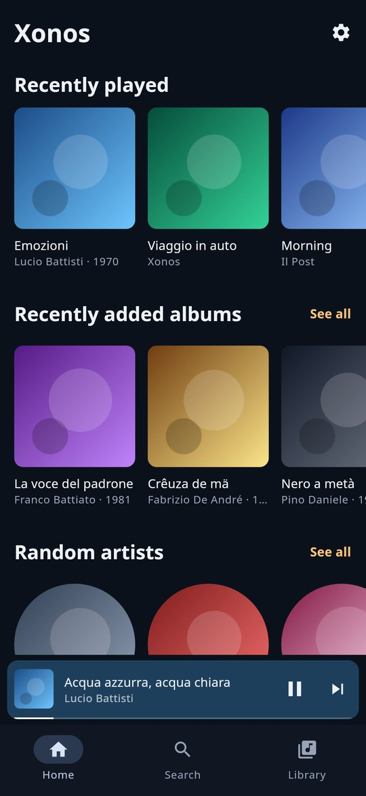

# Xonos

[English](#english) | [Italiano](#italiano)

## English

Music Assistant in your car, through [Gearslip](https://github.com/twinksoftware/Gearslip).

Xonos turns your phone into a [Music Assistant](https://music-assistant.io) player and brings your library to Gearslip’s music player, including split screen next to the map. The music plays on the phone itself, so it reaches the car’s speakers over Bluetooth (or through Gearslip’s USB audio), never your speakers at home.

It’s also a way around Spotify, which refuses to show its library to Gearslip: add Spotify to Music Assistant, and your playlists, liked songs, albums and artists are in Xonos.

Out of the car, Xonos is a music player on the phone too: your whole Music Assistant library, search, a player with synced lyrics and the queue.

<p align="center">
     
</p>

### How it works

- Xonos signs in to Music Assistant with a token and registers the phone as a player through Sendspin, Music Assistant’s own audio protocol. The player is private, like the local player of Music Assistant’s official app: only Xonos controls it, and Music Assistant keeps its queue between trips.
- Gearslip lists Xonos among its music apps. You browse and pick in the car; Gearslip shows what’s playing, the controls, Up next, the lyrics, and the player beside the map.
- The audio arrives as Opus, about 100 kbit/s (some 45 MB an hour of mobile data).

### Getting around

- **The menu** lists Recently played, For you (recommendations from your library and services), Playlists, Albums, Artists, Tracks (every track in the library), Favorite tracks, Genres, Radio, Podcasts, Audiobooks and Browse services (each service’s own folders), in the language chosen on the phone. Empty ones are hidden. Lists are complete, however long: past 150 items they split by initial, A to Z.
- **Albums and playlists** open with a tap; the play button next to them plays them whole. A track inside an album or playlist plays the album or playlist from that track on, so next and previous stay inside it.
- **An artist** shows the most played tracks, every album (those in the library and the whole discography on the services where the artist is), and all the tracks.
- **Search** with Gearslip’s search key: Xonos searches the library and every service connected to Music Assistant, for every kind of item. The best matches come first, one per kind, then a folder per kind with all its results: Brani, Artisti, Album, Playlist, Podcast, Audiolibri, Radio, Generi. Starting or ending with a kind (“podcast morning”, “morning podcast”, “radio deejay”) puts that kind first.
- **The heart** marks the track as a favorite in Music Assistant: you find it in Brani preferiti. Shuffle and repeat work on the Music Assistant queue.
- **Calls and the voice assistant** pause the music, which comes back afterwards. Navigation prompts lower it. If the car’s Bluetooth disconnects, the music pauses instead of moving to the phone’s speaker.
- **No signal** (a tunnel): the phone keeps playing what it has already received, up to about half a minute, then picks up where the music would have been.

### On the phone

- **Home**: what you played recently and Music Assistant’s recommendations (recently added, random artists, favorite playlists…), a row each. Pull down to refresh.
- **Search** while you type, in the library and every service: the best match first, then tracks, artists, albums, playlists, podcasts, audiobooks, radio and genres. Library results show up at once; the services’ follow as they answer.
- **Library**: playlists, albums, artists, tracks, favorite tracks, podcasts, audiobooks, radio, genres and the services’ folders, sorted A to Z, by date added or by last played. Long lists load as you scroll.
- **Albums, playlists, artists, podcasts**: a large cover with its colors in the background, play and shuffle, the heart, and the tracks; tapping one plays from there. Long playlists and artists’ discographies appear piece by piece as they arrive. The ⋮ menu plays a track next, adds it to the queue, adds it (or a whole album or playlist) to a playlist, or opens its album or artist.
- **Playlists you can edit**: add to a playlist from the ⋮ menu or the player, or create a new one there (a Music Assistant playlist, which takes tracks from every service); remove tracks from it with the ⋮ menu; delete Music Assistant playlists from their own menu.
- **The player**: the mini player above the tabs, and full screen with the colors of the cover, the seek bar, shuffle and repeat, the heart, **synced lyrics** (tap a line to jump there) and **the queue**, where the ⋮ of an upcoming track plays it next or removes it. Lyrics come from the files themselves (an `.lrc` file next to the track, or the lyrics tag) or from Music Assistant’s lyrics providers, such as LRCLIB.
- What you start on the phone plays on the phone, and the car shows it the same way: it’s the same player and the same queue.
- **Play on**: from the player (or the cast icon on Home) you can send the music to a speaker Music Assistant knows (Chromecast, AirPlay, Sonos, DLNA, groups…). The queue moves there and carries on from the same point, and the phone stops; the screen then controls that speaker, volume included, and what you play goes there. Choose “This phone” to bring the music back. In the car nothing changes: Gearslip always plays on the phone.
- **Music Assistant services** (for Music Assistant administrators, from Settings, or from Home when the library is empty): see the services, add one (Spotify, Tidal, YouTube Music, Deezer, Qobuz, Jellyfin, Plex, Subsonic, podcasts, radio, folders…), sign in to it in the browser when it asks, change its options, set it up again or remove it. The forms are Music Assistant’s own, in your language when Music Assistant has the translation. Needs Music Assistant 2.10 or later to add and set up services.

### Installation

1. From the [Releases](../../releases) page, download `Xonos.apk` to your phone and install it. Android asks you to allow installing unknown apps; Play Protect may warn that the app is unknown.
2. Open Xonos on your phone: the first time it shows its settings. Pick your language at the top (English, Italiano, Español, Deutsch, Français, Português, Ελληνικά, Русский, 简体中文: English until you choose), and enter:
   - your Music Assistant address at home: Xonos lists the Music Assistant servers it finds on your network, tap yours; otherwise type it, for example `http://homeassistant.local:8095` (the Home Assistant add-on) or `http://192.168.1.10:8095`;
   - the address to use away from home (see below);
   - your Music Assistant username and password (Xonos asks Music Assistant for a token of its own and doesn’t keep the password), or a long-lived access token (in Music Assistant: Settings, Profile, Long-lived access tokens);
   - optionally, the name the phone gets among Music Assistant’s players.
   Tap “Sign in and test the connection” (or “Save and test the connection” with a token): it checks both the API and the audio. Then “Go to your music”. On a Music Assistant just installed, with no users yet, Xonos offers to create the first account (the administrator).
3. Tap “Allow in background”, so Android doesn’t stop the music with the screen off. The settings are behind the gear icon, on Home and in Library.
4. In the car, open Gearslip: Xonos appears among the music apps.

To get updates automatically, add `https://github.com/SirioNero/Music-Assistant-on-Gearslip` to [Obtainium](https://github.com/ImranR98/Obtainium). Each release is named after the app version (`v0.1.N`), so Obtainium can tell when an update is out.

### Away from home

In the car your phone is on mobile data, so the home address doesn’t respond. Xonos tries the home address first, then the remote one, which must reach Music Assistant’s web port (8095): the API and the audio both go through it. You need one of these:

- a VPN on the phone (WireGuard, Tailscale) and a Music Assistant address reachable through it;
- Music Assistant behind an HTTPS reverse proxy, for example `https://music.example.com`, with WebSockets allowed (`/ws` and `/sendspin`).

Home Assistant Cloud (Nabu Casa) only reaches Home Assistant, not Music Assistant’s port, and Music Assistant’s own Remote Access (the `MA-XXXX-XXXX` code) isn’t supported. Avoid a plain `http://` remote address without a VPN: your token would travel unencrypted.

### Requirements

- Music Assistant 2.7.5 or later (checked against 2.10.8 and 2.11.0 beta 7).
- For Spotify, Music Assistant’s Spotify provider, which needs Spotify Premium.

### Troubleshooting

- **The test says “audio: …”.** The API answers but the audio doesn’t: with a reverse proxy, allow WebSockets on `/sendspin` too; Music Assistant before 2.7.5 has no audio for phones.
- **The menu works but there’s no sound.** Check that the phone is connected to the car over Bluetooth, or that Gearslip’s USB audio is on.
- **The music stops with the screen off.** Tap “Allow in background” on the phone, and on some brands (Xiaomi, Huawei, Samsung) also allow Xonos to run in the background in the battery settings.
- **Useful logs**: `adb logcat -s Xonos`.

### Limitations

- The phone’s player is private: Music Assistant’s other apps and Home Assistant don’t offer it as a target. You start the music from Xonos, on the phone or in the car.
- Signing in to a service in the browser (Spotify, Tidal…) brings you back to your Music Assistant’s address: do it at home, or with a remote address that works in the browser too.
- The audio uses Sendspin without its own encryption, a mode Music Assistant accepts by default; the connection is signed in with your token, and encrypted when the address is `https://`.
- One phone, one queue: if you change the player name, Music Assistant keeps the same player and its queue.

### Building

Every push builds the app on GitHub Actions. On the `main` branch, if the `XONOS_KEYSTORE` secret (the signing key, base64-encoded) is set, it also publishes a release with the APK; other branches and pull requests are built only as a check. The key’s password goes in the `XONOS_KEYSTORE_PASSWORD` secret, never in the repository. Plancia’s key works too: set the same value as `PLANCIA_KEYSTORE` and the workflow reads its alias.

The version lives in `app/build.gradle.kts` (`versionCode` and `versionName`) and goes up with every release: the release is tagged `v<versionName>`, and the notes come from `fastlane/metadata/android/*/changelogs/<versionCode>.txt`. If the tag already exists, the workflow refuses to publish.

Locally: open the folder in Android Studio and press Run (the debug build is signed with your computer’s debug key). A release build without `app/xonos.keystore` is left unsigned, as F-Droid wants it.

The F-Droid recipe is in `tools/fdroid/it.xonos.ma.yml`, and the store texts and pictures in `fastlane/`. The “Come F-Droid” workflow builds the app the way F-Droid does and checks it with F-Droid’s own tools.

### Contributing

Bug reports and pull requests are welcome, especially from people trying Xonos in their car with different Music Assistant setups. When you report a problem, include your phone and car, your Gearslip and Music Assistant versions, and what you see and hear.

| File | What it contains |
|---|---|
| `data/MaClient.kt` | WebSocket connection to Music Assistant’s API |
| `data/MaRepository.kt` | Which address answers (home or remote), events, reconnection |
| `data/Library.kt` | The library and queue commands the car uses |
| `sendspin/SendspinClient.kt` | The phone as a Music Assistant player: the Sendspin protocol and clock sync |
| `sendspin/AudioEngine.kt` | Plays the audio at the time the server asks for |
| `sendspin/AndroidAudio.kt` | The phone’s audio output and Opus decoder |
| `playback/PlaybackService.kt` | The music app Gearslip opens: session, menu, focus, notification |
| `playback/MaPlayer.kt` | The player Gearslip sees, mirroring the Music Assistant queue |
| `playback/Menu.kt` | The menu in the car, the search, and what each item plays |
| `playback/BrowseTree.kt` | The menu as Media3 items for Gearslip |
| `playback/ResourceLabels.kt` | The menu’s labels, in the language chosen on the phone |
| `playback/Artwork.kt` | Cover art served to Gearslip |
| `phone/MainActivity.kt`, `phone/ControllerLink.kt` | The app on the phone, and the player it controls |
| `phone/model/` | What the phone app shows and does, without Android: pages, loading, search, playback, lyrics, settings |
| `phone/ui/` | The phone’s screens, in Compose and Material 3 |
| `data/Lyrics.kt` | Synced (LRC) and plain lyrics |
| `Language.kt`, `Texts.kt` | The app’s languages, and problems told in the chosen one |
| `res/values*/strings.xml` | Every text, in English (`values`) and in each language (`values-it`, `values-es`…) |

`tools/` has what’s needed to check Xonos without a phone: a test Music Assistant in Docker, a JVM harness that does what the car and the phone app do, and `tools/screens`, which draws the phone’s screens to PNG with Compose Desktop (see `tools/README.md`).

### Donations

Xonos is free and has no ads. If it’s useful to you, you can support it with bitcoin:

```
bc1qu8q2sc5kuccjj3zpzzfpj85xn7szp73nae9xlx
```

The same address is in the app, at the bottom of Settings, with buttons to copy it or open your wallet.

### License

Xonos is free software: you can redistribute it and/or modify it under the terms of the GNU Affero General Public License, version 3 or (at your option) any later version. See [LICENSE](LICENSE).

## Italiano

Music Assistant in auto, tramite [Gearslip](https://github.com/twinksoftware/Gearslip).

Xonos trasforma il telefono in un lettore di [Music Assistant](https://music-assistant.io) e porta la tua libreria nel lettore musicale di Gearslip, anche nella vista doppia accanto alla mappa. La musica suona sul telefono stesso, quindi arriva alle casse dell’auto via Bluetooth (o con l’audio USB di Gearslip), mai alle casse di casa.

È anche il modo per aggirare Spotify, che a Gearslip non mostra la sua libreria: aggiungi Spotify a Music Assistant, e playlist, brani che ti piacciono, album e artisti sono in Xonos.

Fuori dall’auto, Xonos è un lettore musicale anche sul telefono: tutta la libreria di Music Assistant, la ricerca, un lettore con il testo sincronizzato e la coda.

<p align="center">
     
</p>

### Come funziona

- Xonos accede a Music Assistant con un token e registra il telefono come lettore con Sendspin, il protocollo audio di Music Assistant. Il lettore è privato, come quello dell’app ufficiale di Music Assistant: lo comanda solo Xonos, e Music Assistant gli ricorda la coda da un viaggio all’altro.
- Gearslip trova Xonos tra le app musicali. In auto sfogli e scegli; Gearslip mostra cosa sta suonando, i comandi, i prossimi brani, il testo e il lettore accanto alla mappa.
- L’audio arriva in Opus, circa 100 kbit/s (sui 45 MB di dati all’ora).

### Come si naviga

- **Il menu** elenca Ascoltati di recente, Per te (i consigli della libreria e dei servizi), Playlist, Album, Artisti, Brani (tutti quelli della libreria), Brani preferiti, Generi, Radio, Podcast, Audiolibri e Sfoglia i servizi (le cartelle di ciascun servizio), nella lingua scelta sul telefono. Le voci vuote non compaiono. Gli elenchi sono completi, anche lunghissimi: oltre i 150 elementi si dividono per iniziale, dalla A alla Z.
- **Album e playlist** si aprono con un tocco; il tasto play accanto li suona interi. Un brano dentro un album o una playlist li fa partire da quel brano, così avanti e indietro restano lì dentro.
- **Un artista** mostra i brani più ascoltati, tutti gli album (quelli in libreria e la discografia intera dei servizi dove l’artista c’è) e tutti i brani.
- **La ricerca** è il tasto cerca di Gearslip: Xonos cerca nella libreria e in tutti i servizi collegati a Music Assistant, ogni tipo di elemento. In cima ci sono i risultati migliori, uno per tipo, poi una cartella per tipo con tutti i suoi risultati: Brani, Artisti, Album, Playlist, Podcast, Audiolibri, Radio, Generi. Se cominci o finisci con un tipo (“podcast morning”, “morning podcast”, “radio deejay”) quel tipo va per primo.
- **Il cuore** segna il brano tra i preferiti di Music Assistant: lo ritrovi in Brani preferiti. Casuale e ripeti agiscono sulla coda di Music Assistant.
- **Telefonate e assistente vocale** mettono in pausa la musica, che poi riprende. Le indicazioni del navigatore la abbassano. Se il Bluetooth dell’auto si stacca, la musica si ferma invece di passare all’altoparlante del telefono.
- **Senza campo** (una galleria) il telefono continua a suonare quello che ha già ricevuto, fino a una mezzo minuto, poi riprende da dove la musica sarebbe arrivata.

### Sul telefono

- **Home**: gli ascolti recenti e i consigli di Music Assistant (aggiunti di recente, artisti a caso, playlist preferite…), una riga ciascuno. Trascina in giù per aggiornare.
- **Cerca** mentre scrivi, nella libreria e in tutti i servizi: prima il risultato migliore, poi brani, artisti, album, playlist, podcast, audiolibri, radio e generi. I risultati della libreria compaiono subito, quelli dei servizi man mano che rispondono.
- **Libreria**: playlist, album, artisti, brani, brani preferiti, podcast, audiolibri, radio, generi e le cartelle dei servizi, in ordine dalla A alla Z, per data di aggiunta o per ultimo ascolto. Gli elenchi lunghi si caricano mentre scorri.
- **Album, playlist, artisti, podcast**: copertina grande con i suoi colori sullo sfondo, play e casuale, il cuore e i brani; toccandone uno si parte da lì. Le playlist lunghe e la discografia di un artista compaiono a pezzi, man mano che arrivano. Il menu ⋮ mette un brano subito dopo, lo aggiunge alla coda, lo mette (anche un album o una playlist interi) in una playlist, o apre il suo album o il suo artista.
- **Playlist modificabili**: dal menu ⋮ o dal lettore aggiungi a una playlist, o ne crei una nuova lì (una playlist di Music Assistant, che accetta brani di tutti i servizi); dal menu ⋮ togli un brano dalla playlist; le playlist di Music Assistant si eliminano dal loro menu.
- **Il lettore**: il mini-lettore sopra le schede, e a schermo intero con i colori della copertina, la barra per spostarsi, casuale e ripeti, il cuore, il **testo sincronizzato** (tocca una riga per andarci) e **la coda**, dove i ⋮ di un brano in arrivo lo fanno suonare dopo o lo tolgono. I testi vengono dai file stessi (un file `.lrc` accanto al brano, o il tag del testo) o dai servizi di testi di Music Assistant, come LRCLIB.
- Quello che fai partire dal telefono suona sul telefono, e l’auto lo mostra allo stesso modo: è lo stesso lettore con la stessa coda.
- **Suona su**: dal lettore (o dall’icona in alto nella Home) mandi la musica a una cassa che Music Assistant conosce (Chromecast, AirPlay, Sonos, DLNA, gruppi…). La coda passa lì e continua dallo stesso punto, e il telefono si ferma; da quel momento lo schermo comanda quella cassa, volume compreso, e quello che fai partire suona lì. Scegli “Questo telefono” per riportare indietro la musica. In auto non cambia niente: Gearslip suona sempre sul telefono.
- **I servizi di Music Assistant** (per chi amministra Music Assistant, dalle Impostazioni, o dalla Home quando la libreria è vuota): vedi i servizi, ne aggiungi uno (Spotify, Tidal, YouTube Music, Deezer, Qobuz, Jellyfin, Plex, Subsonic, podcast, radio, cartelle…), fai l’accesso nel browser quando lo chiede, cambi le opzioni, lo configuri di nuovo o lo togli. I moduli sono quelli di Music Assistant, nella tua lingua quando Music Assistant ha la traduzione. Per aggiungere e configurare i servizi serve Music Assistant 2.10 o successivo.

### Installazione

1. Dalla pagina [Releases](../../releases) scarica `Xonos.apk` sul telefono e installalo. Android chiede di consentire l’installazione di app sconosciute; Play Protect può avvisare che l’app non è nota.
2. Apri Xonos sul telefono: la prima volta mostra le impostazioni. Scegli in cima la lingua (English, Italiano, Español, Deutsch, Français, Português, Ελληνικά, Русский, 简体中文: finché non la scegli è l’inglese) e inserisci:
   - l’indirizzo di casa di Music Assistant: Xonos elenca i Music Assistant che trova nella tua rete, tocca il tuo; altrimenti scrivilo, per esempio `http://homeassistant.local:8095` (il componente aggiuntivo di Home Assistant) oppure `http://192.168.1.10:8095`;
   - l’indirizzo da fuori casa (vedi sotto);
   - nome utente e password di Music Assistant (Xonos si fa dare da Music Assistant un token suo e la password non la tiene), oppure un token di accesso a lungo termine (in Music Assistant: Impostazioni, Profilo, Token di accesso a lungo termine);
   - se vuoi, il nome del telefono tra i lettori di Music Assistant.
   Premi “Accedi e prova la connessione” (o “Salva e prova la connessione” con un token): controlla sia l’API sia l’audio. Poi “Vai alla tua musica”. Su un Music Assistant appena installato, ancora senza utenti, Xonos propone di creare il primo account (l’amministratore).
3. Premi “Consenti in background”, così Android non ferma la musica a schermo spento. Le impostazioni stanno dietro l’ingranaggio, nella Home e nella Libreria.
4. In auto apri Gearslip: Xonos compare tra le app musicali.

Per ricevere gli aggiornamenti in automatico, aggiungi `https://github.com/SirioNero/Music-Assistant-on-Gearslip` a [Obtainium](https://github.com/ImranR98/Obtainium). Ogni release ha il nome della versione dell’app (`v0.1.N`), così Obtainium capisce quando c’è un aggiornamento.

### Fuori casa

In auto il telefono usa la rete mobile, quindi l’indirizzo di casa non risponde. Xonos prova prima quello di casa e poi quello remoto, che deve arrivare alla porta web di Music Assistant (8095): da lì passano sia l’API sia l’audio. Serve uno di questi:

- una VPN sul telefono (WireGuard, Tailscale) e l’indirizzo di Music Assistant raggiungibile attraverso di essa;
- Music Assistant dietro un reverse proxy HTTPS, per esempio `https://musica.example.com`, con i WebSocket consentiti (`/ws` e `/sendspin`).

Home Assistant Cloud (Nabu Casa) arriva solo a Home Assistant, non alla porta di Music Assistant, e l’accesso remoto di Music Assistant (il codice `MA-XXXX-XXXX`) non è supportato. Evita un indirizzo remoto in `http://` senza VPN: il token viaggerebbe in chiaro.

### Requisiti

- Music Assistant 2.7.5 o successivo (verificato con la 2.10.8 e la 2.11.0 beta 7).
- Per Spotify, il provider Spotify di Music Assistant, che vuole Spotify Premium.

### Se qualcosa non va

- **La prova dice “audio: …”.** L’API risponde ma l’audio no: con un reverse proxy consenti i WebSocket anche su `/sendspin`; Music Assistant prima della 2.7.5 non ha l’audio per i telefoni.
- **Il menu funziona ma non si sente niente.** Controlla che il telefono sia collegato all’auto via Bluetooth, o che l’audio USB di Gearslip sia attivo.
- **La musica si ferma a schermo spento.** Premi “Consenti in background” sul telefono e, su alcune marche (Xiaomi, Huawei, Samsung), consenti a Xonos di funzionare in background anche nelle impostazioni della batteria.
- **Log utili**: `adb logcat -s Xonos`.

### Limiti

- Il lettore del telefono è privato: le altre app di Music Assistant e Home Assistant non lo offrono come destinazione. La musica la fai partire da Xonos, sul telefono o in auto.
- L’accesso a un servizio nel browser (Spotify, Tidal…) torna all’indirizzo del tuo Music Assistant: fallo a casa, o con un indirizzo remoto che funzioni anche nel browser.
- L’audio usa Sendspin senza la sua cifratura, una modalità che Music Assistant accetta di serie; la connessione è comunque autenticata dal token, e cifrata quando l’indirizzo è `https://`.
- Un telefono, una coda: se cambi il nome del lettore, Music Assistant tiene lo stesso lettore e la sua coda.

### Compilare

Ogni push compila l’app su GitHub Actions. Sul ramo `main`, se è configurato il secret `XONOS_KEYSTORE` (la chiave di firma in base64), pubblica anche una release con l’APK; gli altri rami e le pull request vengono compilati solo per controllo. La password della chiave va nel secret `XONOS_KEYSTORE_PASSWORD`, mai nel repository. Va bene anche la chiave di Plancia: metti lo stesso valore come `PLANCIA_KEYSTORE` e il workflow ne legge l’alias.

La versione sta in `app/build.gradle.kts` (`versionCode` e `versionName`) e si alza a ogni release: la release ha il tag `v<versionName>`, e le note vengono da `fastlane/metadata/android/*/changelogs/<versionCode>.txt`. Se il tag c’è già, il workflow non pubblica.

In locale: apri la cartella in Android Studio e premi Run (la versione di debug si firma con la chiave di debug del proprio computer). Una release senza `app/xonos.keystore` resta non firmata, come la vuole F-Droid.

La ricetta per F-Droid sta in `tools/fdroid/it.xonos.ma.yml`, testi e immagini per lo store in `fastlane/`. Il workflow “Come F-Droid” compila l’app come la compila F-Droid e la controlla con i suoi strumenti.

### Contribuire

Segnalazioni e pull request sono benvenute, soprattutto da chi prova Xonos in auto con impianti Music Assistant diversi. Quando segnali un problema indica telefono e auto, la versione di Gearslip e di Music Assistant, e cosa vedi e senti.

| File | Cosa contiene |
|---|---|
| `data/MaClient.kt` | Connessione WebSocket all’API di Music Assistant |
| `data/MaRepository.kt` | Quale indirizzo risponde (casa o remoto), eventi, riconnessione |
| `data/Library.kt` | I comandi di libreria e coda che usa l’auto |
| `sendspin/SendspinClient.kt` | Il telefono come lettore di Music Assistant: il protocollo Sendspin e l’orologio |
| `sendspin/AudioEngine.kt` | Suona l’audio al momento che chiede il server |
| `sendspin/AndroidAudio.kt` | L’uscita audio del telefono e il decoder Opus |
| `playback/PlaybackService.kt` | L’app musicale che apre Gearslip: sessione, menu, audio condiviso, notifica |
| `playback/MaPlayer.kt` | Il lettore che vede Gearslip, specchio della coda di Music Assistant |
| `playback/Menu.kt` | Il menu in auto, la ricerca e cosa suona ogni voce |
| `playback/BrowseTree.kt` | Il menu come voci di Media3 per Gearslip |
| `playback/ResourceLabels.kt` | Le scritte del menu, nella lingua scelta sul telefono |
| `playback/Artwork.kt` | Le copertine passate a Gearslip |
| `phone/MainActivity.kt`, `phone/ControllerLink.kt` | L’app sul telefono, e il lettore che comanda |
| `phone/model/` | Cosa mostra e fa l’app del telefono, senza Android: schermate, caricamenti, ricerca, riproduzione, testi, impostazioni |
| `phone/ui/` | Le schermate del telefono, con Compose e Material 3 |
| `data/Lyrics.kt` | I testi sincronizzati (LRC) e semplici |
| `Language.kt`, `Texts.kt` | Le lingue dell’app, e i problemi detti in quella scelta |
| `res/values*/strings.xml` | Tutti i testi, in inglese (`values`) e in ogni lingua (`values-it`, `values-es`…) |

In `tools/` c’è ciò che serve per provare Xonos senza telefono: un Music Assistant di prova in Docker, un banco di prova sulla JVM che fa ciò che fanno l’auto e l’app del telefono, e `tools/screens`, che disegna in PNG le schermate del telefono con Compose Desktop (vedi `tools/README.md`).

### Donazioni

Xonos è gratuito e senza pubblicità. Se ti è utile, puoi sostenerlo con dei bitcoin:

```
bc1qu8q2sc5kuccjj3zpzzfpj85xn7szp73nae9xlx
```

Lo stesso indirizzo è nell’app, in fondo alle Impostazioni, con i pulsanti per copiarlo o aprire il tuo portafoglio.

### Licenza

Xonos è software libero: puoi ridistribuirlo e modificarlo secondo i termini della GNU Affero General Public License, versione 3 o (a tua scelta) successiva. Vedi [LICENSE](LICENSE).
