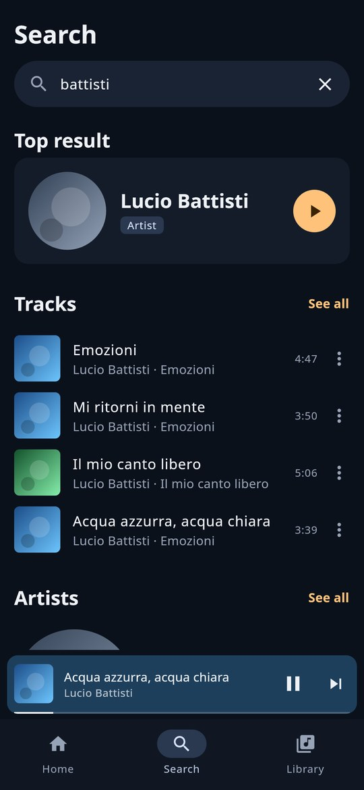
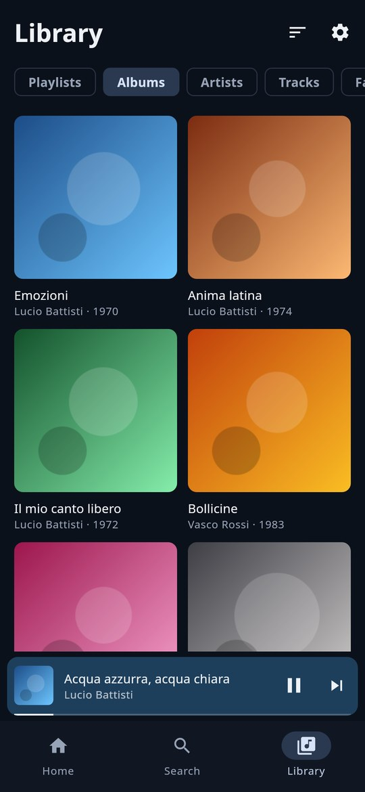
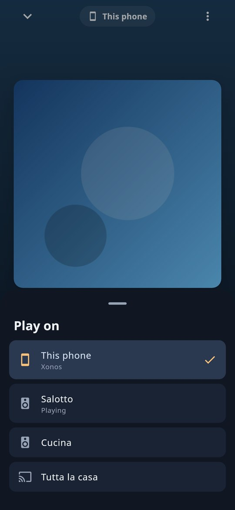

  

<h1 align="center">Xonos</h1>

  <strong>Your whole Music Assistant library, in the car.</strong> 
  Spotify, Tidal, Plex, Jellyfin, your own files, podcasts and radio: on the car’s screen with Gearslip and myCar, and in your pocket.

  
  
  
  
  

  <a href="#english">English</a> · <a href="#español">Español</a> · <a href="#français">Français</a> · <a href="#deutsch">Deutsch</a> · <a href="#italiano">Italiano</a> · <a href="#português">Português</a>

     

## English

**Xonos turns your phone into a Music Assistant player and puts your whole library on the car’s screen.** Pick an album, a playlist, a podcast or a radio station in [Gearslip](https://github.com/twinksoftware/Gearslip) or [myCar](https://github.com/SirioNero/MyCar): it plays on the phone and comes out of the car’s speakers, never out of your speakers at home. Out of the car, Xonos is a complete music player for your [Music Assistant](https://music-assistant.io).

### Highlights

- 🚗 **Everything, in the car.** Playlists, albums, artists, podcasts, audiobooks and radio from every service in Music Assistant, with the full menu, search, lyrics and the player beside the map.
- 🎶 **Your Spotify library too.** Spotify won’t show its library to Gearslip: add Spotify to Music Assistant, and your playlists, liked songs, albums and artists are in Xonos.
- 📱 **A real player on the phone.** Recommendations on Home, search as you type, the whole library, synced lyrics, a queue and playlists you can edit.
- 🔊 **Play on any speaker.** Send the music to the speakers Music Assistant knows (Chromecast, AirPlay, Sonos, DLNA, groups) and bring it back to the phone, from the same point.
- 🛠️ **Music Assistant in your hand.** Administrators add services, sign in to them and set them up right from the phone.
- 🌍 **Nine languages.** English, Español, Français, Deutsch, Italiano, Português, Ελληνικά, Русский, 简体中文.
- 🔒 **Yours alone.** No ads, no tracking, no account with anyone but your own Music Assistant. Free software (AGPL-3.0), with reproducible builds.

### In the car

Xonos signs in to Music Assistant and registers the phone as a private player through Sendspin, Music Assistant’s own audio protocol: only Xonos controls it, and Music Assistant keeps its queue from one trip to the next. Gearslip and myCar list Xonos among their music apps: you browse and choose in the car, and see what’s playing, the controls, Up next, the lyrics and the player beside the map.

- **The menu**: Recently played, For you (recommendations from your library and services), Playlists, Albums, Artists, Tracks, Favorite tracks, Genres, Radio, Podcasts, Audiobooks and Browse services (each service’s own folders), in the language chosen on the phone. Empty ones are hidden. Lists are complete however long they are: past 150 items they split by initial, A to Z.
- **Albums and playlists** open with a tap, and the play button beside them plays them whole. A track inside an album or a playlist plays it from that track on, so next and previous stay inside it.
- **An artist** shows the most played tracks, every album (those in your library and the whole discography on the services that have the artist) and all the tracks.
- **Search** with the search key: Xonos searches the library and every service connected to Music Assistant, for every kind of item. The best matches come first, one per kind, then a folder per kind with all its results: Tracks, Artists, Albums, Playlists, Podcasts, Audiobooks, Radio, Genres. Start or end with a kind (“podcast morning”, “morning podcast”, “radio deejay”) to put that kind first.
- **The heart** saves the track to Music Assistant’s favorites, where Favorite tracks finds it. Shuffle and repeat work on the Music Assistant queue.
- **Calls and the voice assistant** pause the music, which comes back afterwards; navigation prompts lower it. If the car’s Bluetooth disconnects, the music pauses instead of moving to the phone’s speaker.
- **No signal** (a tunnel): the phone keeps playing what it has already received, up to about half a minute, then picks up where the music would have been.
- **Data**: the audio arrives as Opus at about 100 kbit/s, some 45 MB an hour.

### On the phone

- **Home**: what you played recently and Music Assistant’s recommendations (recently added, random artists, favorite playlists…), a row each. Pull down to refresh.
- **Search** as you type, in the library and every service: the top result first, then tracks, artists, albums, playlists, podcasts, audiobooks, radio and genres. Library results show up at once, the services’ as they answer.
- **Library**: playlists, albums, artists, tracks, favorite tracks, podcasts, audiobooks, radio, genres and the services’ folders, sorted A to Z, by date added or by last played. Long lists load as you scroll.
- **Albums, playlists, artists, podcasts**: a large cover with its colors in the background, play and shuffle, the heart and the tracks; tap one to play from there. Long playlists and discographies appear piece by piece as they arrive. The ⋮ menu has Play next, Add to queue, Add to playlist (a track, or a whole album or playlist), Go to album and Go to artist.
- **Playlists you can edit**: add to a playlist from the ⋮ menu or the player, or create a new one right there (a Music Assistant playlist, which takes tracks from every service); remove tracks with the ⋮ menu; delete Music Assistant playlists from their own menu.
- **The player**: the mini player above the tabs, and full screen with the colors of the cover, the seek bar, shuffle and repeat, the heart, **synced lyrics** (tap a line to jump there) and **Up next**, where the ⋮ of an upcoming track plays it next or removes it. Lyrics come from your files (an `.lrc` file next to the track, or the lyrics tag) or from Music Assistant’s lyrics providers, such as LRCLIB.
- **One player, one queue**: what you start on the phone plays on the phone, and the car shows it the same way.
- **Play on**: from the player, or the cast icon on Home, send the music to a speaker Music Assistant knows. The queue moves there and carries on from the same point, and the phone stops; the screen then controls that speaker, volume included, and what you play goes there. Choose “This phone” to bring the music back. In the car nothing changes: the car always plays on the phone.
- **Music Assistant services** (for administrators, from Settings, or from Home when the library is empty): see the services, add one (Spotify, Tidal, YouTube Music, Deezer, Qobuz, Jellyfin, Plex, Subsonic, podcasts, radio, folders…), sign in to it in the browser when it asks, change its options, set it up again or remove it. The forms are Music Assistant’s own, in your language when Music Assistant has the translation. Adding and setting up services needs Music Assistant 2.10 or later.

    

### With myCar

[myCar](https://github.com/SirioNero/MyCar), an independent fork of Gearslip, has Xonos built in, with the same engine. Set up Xonos on the phone (0.1.39 or later) and myCar picks up your Music Assistant account by itself: nothing to type twice. Xonos hands the account only to myCar, recognized by its signing certificate, and no other app can read it. When the car’s audio goes through myCar, the music goes straight into the car’s audio channel, and while Xonos is playing Android doesn’t ask for permission to capture the screen.

### Get started

1. From the [Releases](https://github.com/SirioNero/Music-Assistant-on-Gearslip/releases) page, download `Xonos.apk` to your phone and install it. Android asks you to allow installing unknown apps; Play Protect may warn that it doesn’t know the app.
2. Open Xonos: the first time, it shows its settings. Pick your language at the top (English until you choose), then enter:
   - your Music Assistant address at home: Xonos lists the Music Assistant servers it finds on your network, so tap yours; otherwise type it, for example `http://homeassistant.local:8095` (the Home Assistant add-on) or `http://192.168.1.10:8095`;
   - the address to use away from home (see below);
   - your Music Assistant username and password (Xonos asks Music Assistant for a token of its own and doesn’t keep the password), or a long-lived access token (in Music Assistant: Settings, Profile, Long-lived access tokens);
   - if you like, the name the phone gets among Music Assistant’s players.

   Tap **Sign in and test the connection** (with a token, **Save and test the connection**): it checks both the API and the audio. Then **Go to your music**. On a Music Assistant just installed, with no users yet, Xonos offers to create the first account, the administrator.
3. Tap **Allow in background**, so Android doesn’t stop the music with the screen off. The settings are behind the gear icon, on Home and in Library.
4. In the car, open Gearslip: Xonos is among the music apps. In myCar it’s built in (see above).

**Updates**: add `https://github.com/SirioNero/Music-Assistant-on-Gearslip` to [Obtainium](https://github.com/ImranR98/Obtainium). Each release is named after the app version (`v0.1.N`), so Obtainium can tell when an update is out.

### Away from home

In the car the phone is on mobile data, so the home address doesn’t answer. Xonos tries the home address first, then the remote one, which must reach Music Assistant’s web port (8095): the API and the audio both go through it. You need one of these:

- a VPN on the phone (WireGuard, Tailscale) and a Music Assistant address reachable through it;
- Music Assistant behind an HTTPS reverse proxy, for example `https://music.example.com`, with WebSockets allowed (`/ws` and `/sendspin`).

Home Assistant Cloud (Nabu Casa) reaches only Home Assistant, not Music Assistant’s port, and Music Assistant’s own Remote Access (the `MA-XXXX-XXXX` code) isn’t supported. Avoid a plain `http://` remote address without a VPN: your token would travel unencrypted.

### Requirements

- Android 8.0 or later.
- Music Assistant 2.7.5 or later (checked against 2.10.8 and 2.11.0 beta 7); adding and setting up services from the app needs 2.10.
- In the car, Gearslip or myCar.
- For Spotify, Music Assistant’s Spotify provider, which needs Spotify Premium.

### Troubleshooting

- **The test says “audio: …”.** The API answers but the audio doesn’t: with a reverse proxy, allow WebSockets on `/sendspin` too; Music Assistant before 2.7.5 has no audio for phones.
- **The menu works but there’s no sound.** Check that the phone is connected to the car over Bluetooth, or that the car’s audio goes through Gearslip (its USB audio) or myCar.
- **The music stops with the screen off.** Tap “Allow in background” on the phone and, on some brands (Xiaomi, Huawei, Samsung), also let Xonos run in the background in the battery settings.
- **Useful logs**: `adb logcat -s Xonos`.

### Good to know

- The phone’s player is private: Music Assistant’s other apps and Home Assistant don’t offer it as a target. You start the music from Xonos, on the phone or in the car.
- Signing in to a service in the browser (Spotify, Tidal…) brings you back to your Music Assistant’s address: do it at home, or with a remote address that works in the browser too.
- The audio uses Sendspin without its own encryption, a mode Music Assistant accepts by default; the connection is signed in with your token, and encrypted when the address is `https://`.
- One phone, one queue: if you change the player name, Music Assistant keeps the same player and its queue.

### Building

Every push builds the app on GitHub Actions. On the `main` branch, if the `XONOS_KEYSTORE` secret (the signing key, base64-encoded) is set, it also publishes a release with the APK; other branches and pull requests are built only as a check. Plancia’s key works too: set the same value as `PLANCIA_KEYSTORE` and the workflow reads its alias. If the key has its own password, put it in `XONOS_KEYSTORE_PASSWORD`.

The version lives in `app/build.gradle.kts` (`versionCode` and `versionName`) and goes up with every release: the release is tagged `v<versionName>`, and its notes come from `fastlane/metadata/android/*/changelogs/<versionCode>.txt`. If the tag already exists, the workflow refuses to publish.

Locally: open the folder in Android Studio and press Run (the debug build is signed with your computer’s debug key). A release build without `app/xonos.keystore` is left unsigned, as F-Droid wants it.

The F-Droid recipe is in `tools/fdroid/it.xonos.ma.yml`, and the store texts and pictures in `fastlane/`. The “Come F-Droid” workflow builds the app the way F-Droid does and checks it with F-Droid’s own tools; the “Riproducibile” workflow rebuilds a release that way and compares it with the published APK, byte for byte.

### Contributing

Bug reports and pull requests are welcome, especially from people trying Xonos in their car with different Music Assistant setups. When you report a problem, include your phone and car, your Gearslip or myCar and Music Assistant versions, and what you see and hear.

| File | What it contains |
|---|---|
| `data/MaClient.kt` | WebSocket connection to Music Assistant’s API |
| `data/MaRepository.kt` | Which address answers (home or remote), events, reconnection |
| `data/Library.kt` | The library and queue commands the car uses |
| `data/Services.kt` | Music Assistant’s services: the list, their forms and their setup steps |
| `data/Devices.kt` | The speakers for Play on, and moving the queue to them |
| `data/AccountProvider.kt` | The Music Assistant account handed to myCar, and to no other app |
| `sendspin/SendspinClient.kt` | The phone as a Music Assistant player: the Sendspin protocol and clock sync |
| `sendspin/AudioEngine.kt` | Plays the audio at the time the server asks for |
| `sendspin/AndroidAudio.kt` | The phone’s audio output and Opus decoder |
| `playback/PlaybackService.kt` | The music app Gearslip opens: session, menu, focus, notification |
| `playback/MaPlayer.kt` | The player Gearslip sees, mirroring the Music Assistant queue |
| `playback/Menu.kt` | The menu in the car, the search, and what each item plays |
| `playback/BrowseTree.kt` | The menu as Media3 items for Gearslip |
| `playback/ResourceLabels.kt` | The menu’s labels, in the language chosen on the phone |
| `playback/Artwork.kt` | Cover art served to Gearslip |
| `phone/MainActivity.kt`, `phone/ControllerLink.kt` | The app on the phone, and the player it controls |
| `phone/model/` | What the phone app shows and does, without Android: pages, loading, search, playback, lyrics, settings |
| `phone/ui/` | The phone’s screens, in Compose and Material 3 |
| `data/Lyrics.kt` | Synced (LRC) and plain lyrics |
| `Language.kt`, `Texts.kt` | The app’s languages, and problems told in the chosen one |
| `res/values*/strings.xml` | Every text, in English (`values`) and in each language (`values-it`, `values-es`…) |

`tools/` has what’s needed to check Xonos without a phone: a test Music Assistant in Docker, a JVM harness that does what the car and the phone app do, and `tools/screens`, which draws the phone’s screens to PNG with Compose Desktop (see `tools/README.md`).

### License

Xonos is free software: you can redistribute it and/or modify it under the terms of the GNU Affero General Public License, version 3 or (at your option) any later version. See [LICENSE](LICENSE).

Xonos is an independent project, not affiliated with Music Assistant, Gearslip or any music service.

## Español

**Xonos convierte tu teléfono en un reproductor de Music Assistant y lleva toda tu biblioteca a la pantalla del coche.** Elige un álbum, una playlist, un pódcast o una emisora en [Gearslip](https://github.com/twinksoftware/Gearslip) o en [myCar](https://github.com/SirioNero/MyCar): suena en el teléfono y sale por los altavoces del coche, nunca por los de casa. Fuera del coche, Xonos es un reproductor completo para tu [Music Assistant](https://music-assistant.io).

### Lo mejor

- 🚗 **Todo, en el coche.** Playlists, álbumes, artistas, pódcasts, audiolibros y radio de todos los servicios de Music Assistant, con el menú completo, la búsqueda, la letra y el reproductor junto al mapa.
- 🎶 **También tu biblioteca de Spotify.** Spotify no le enseña su biblioteca a Gearslip: añade Spotify a Music Assistant y tus playlists, canciones que te gustan, álbumes y artistas estarán en Xonos.
- 📱 **Un reproductor de verdad en el teléfono.** Recomendaciones en Inicio, búsqueda mientras escribes, toda la biblioteca, letras sincronizadas, una cola y playlists que puedes editar.
- 🔊 **Suena en cualquier altavoz.** Envía la música a los altavoces que conoce Music Assistant (Chromecast, AirPlay, Sonos, DLNA, grupos) y tráela de vuelta al teléfono, desde el mismo punto.
- 🛠️ **Music Assistant en tu mano.** Quien lo administra añade servicios, inicia sesión en ellos y los configura desde el propio teléfono.
- 🌍 **Nueve idiomas.** English, Español, Français, Deutsch, Italiano, Português, Ελληνικά, Русский, 简体中文.
- 🔒 **Solo tuyo.** Sin anuncios, sin rastreo, sin más cuentas que la de tu propio Music Assistant. Software libre (AGPL-3.0), con compilaciones reproducibles.

### En el coche

Xonos inicia sesión en Music Assistant y registra el teléfono como reproductor privado con Sendspin, el protocolo de audio de Music Assistant: solo Xonos lo controla, y Music Assistant le guarda la cola de un viaje a otro. Gearslip y myCar muestran Xonos entre sus apps de música: en el coche exploras y eliges, y ves lo que suena, los controles, lo que viene a continuación, la letra y el reproductor junto al mapa.

- **El menú**: Escuchado recientemente, Para ti (recomendaciones de tu biblioteca y de los servicios), Playlists, Álbumes, Artistas, Canciones, Canciones favoritas, Géneros, Radio, Pódcasts, Audiolibros y Explorar servicios (las carpetas de cada servicio), en el idioma elegido en el teléfono. Las secciones vacías no aparecen. Las listas están completas, por largas que sean: a partir de 150 elementos se dividen por inicial, de la A a la Z.
- **Álbumes y playlists** se abren con un toque, y el botón de reproducir que tienen al lado los reproduce enteros. Una canción dentro de un álbum o una playlist lo reproduce desde esa canción, así que siguiente y anterior se quedan dentro.
- **Un artista** muestra sus canciones más escuchadas, todos sus álbumes (los de tu biblioteca y la discografía completa en los servicios donde está) y todas sus canciones.
- **Busca** con la tecla de búsqueda: Xonos busca en la biblioteca y en todos los servicios conectados a Music Assistant, todo tipo de elementos. Primero van los mejores resultados, uno por tipo, y después una carpeta por tipo con todos sus resultados: Canciones, Artistas, Álbumes, Playlists, Pódcasts, Audiolibros, Radio, Géneros. Si empiezas o terminas con un tipo («pódcast noticias», «noticias pódcast», «radio cadena ser»), ese tipo va primero.
- **El corazón** guarda la canción en los favoritos de Music Assistant: la encuentras en Canciones favoritas. Aleatorio y repetir actúan sobre la cola de Music Assistant.
- **Las llamadas y el asistente de voz** pausan la música, que vuelve después; las indicaciones del navegador la bajan. Si se desconecta el Bluetooth del coche, la música se pausa en lugar de pasar al altavoz del teléfono.
- **Sin cobertura** (un túnel): el teléfono sigue sonando con lo que ya ha recibido, hasta medio minuto más o menos, y luego retoma donde habría llegado la música.
- **Datos**: el audio llega en Opus, a unos 100 kbit/s (unos 45 MB por hora).

### En el teléfono

- **Inicio**: lo que has escuchado hace poco y las recomendaciones de Music Assistant (añadidos recientemente, artistas al azar, playlists favoritas…), una fila cada una. Desliza hacia abajo para actualizar.
- **Buscar** mientras escribes, en la biblioteca y en todos los servicios: primero el mejor resultado, después canciones, artistas, álbumes, playlists, pódcasts, audiolibros, radio y géneros. Los resultados de la biblioteca aparecen al momento; los de los servicios, según van respondiendo.
- **Biblioteca**: playlists, álbumes, artistas, canciones, canciones favoritas, pódcasts, audiolibros, radio, géneros y las carpetas de los servicios, de la A a la Z, por fecha en que se añadieron o por última escucha. Las listas largas se cargan mientras te desplazas.
- **Álbumes, playlists, artistas, pódcasts**: portada grande con sus colores de fondo, reproducir y aleatorio, el corazón y las canciones; toca una para reproducir desde ahí. Las playlists largas y las discografías aparecen por partes, según llegan. El menú ⋮ tiene Reproducir a continuación, Añadir a la cola, Añadir a una playlist (una canción, o un álbum o una playlist enteros), Ir al álbum e Ir al artista.
- **Playlists editables**: añade a una playlist desde el menú ⋮ o desde el reproductor, o crea una nueva ahí mismo (una playlist de Music Assistant, que acepta canciones de todos los servicios); quita canciones con el menú ⋮; elimina las playlists de Music Assistant desde su propio menú.
- **El reproductor**: el minirreproductor encima de las pestañas, y a pantalla completa con los colores de la portada, la barra de progreso, aleatorio y repetir, el corazón, la **letra sincronizada** (toca una línea para saltar ahí) y **A continuación**, donde el ⋮ de una canción que viene la pone a continuación o la quita. Las letras salen de tus archivos (un archivo `.lrc` junto a la canción, o la etiqueta de la letra) o de los proveedores de letras de Music Assistant, como LRCLIB.
- **Un reproductor, una cola**: lo que empiezas en el teléfono suena en el teléfono, y el coche lo muestra igual.
- **Reproducir en**: desde el reproductor, o desde el icono de enviar en Inicio, manda la música a un altavoz que conozca Music Assistant. La cola pasa allí y sigue desde el mismo punto, y el teléfono se detiene; desde entonces la pantalla controla ese altavoz, volumen incluido, y lo que reproduces va allí. Elige «Este teléfono» para recuperar la música. En el coche no cambia nada: el coche siempre suena en el teléfono.
- **Servicios de Music Assistant** (para quien lo administra, desde Ajustes, o desde Inicio cuando la biblioteca está vacía): mira los servicios, añade uno (Spotify, Tidal, YouTube Music, Deezer, Qobuz, Jellyfin, Plex, Subsonic, pódcasts, radio, carpetas…), inicia sesión en el navegador cuando lo pida, cambia sus opciones, configúralo de nuevo o quítalo. Los formularios son los de Music Assistant, en tu idioma cuando Music Assistant tiene la traducción. Para añadir y configurar servicios hace falta Music Assistant 2.10 o posterior.

### Con myCar

[myCar](https://github.com/SirioNero/MyCar), un fork independiente de Gearslip, lleva Xonos integrado, con el mismo motor. Configura Xonos en el teléfono (0.1.39 o posterior) y myCar toma tu cuenta de Music Assistant por sí solo: no hay nada que escribir dos veces. Xonos entrega la cuenta solo a myCar, reconocida por su certificado de firma, y ninguna otra app puede leerla. Cuando el audio del coche pasa por myCar, la música va directa al canal de audio del coche, y mientras suena Xonos Android no pide permiso para capturar la pantalla.

### Primeros pasos

1. Desde la página [Releases](https://github.com/SirioNero/Music-Assistant-on-Gearslip/releases), descarga `Xonos.apk` en el teléfono e instálalo. Android te pedirá permitir la instalación de apps desconocidas; Play Protect puede avisar de que no conoce la app.
2. Abre Xonos: la primera vez muestra sus ajustes. Elige el idioma arriba (inglés hasta que lo cambies) y escribe:
   - la dirección de Music Assistant en casa: Xonos muestra los Music Assistant que encuentra en tu red, así que toca el tuyo; si no, escríbela, por ejemplo `http://homeassistant.local:8095` (el complemento de Home Assistant) o `http://192.168.1.10:8095`;
   - la dirección para fuera de casa (mira más abajo);
   - tu usuario y contraseña de Music Assistant (Xonos le pide a Music Assistant un token propio y no guarda la contraseña), o un token de acceso de larga duración (en Music Assistant: Ajustes, Perfil, Tokens de acceso de larga duración);
   - si quieres, el nombre del teléfono entre los reproductores de Music Assistant.

   Pulsa **Iniciar sesión y probar la conexión** (con un token, **Guardar y probar la conexión**): comprueba tanto la API como el audio. Después, **Ir a tu música**. En un Music Assistant recién instalado, todavía sin usuarios, Xonos ofrece crear la primera cuenta, la de administrador.
3. Pulsa **Permitir en segundo plano**, para que Android no detenga la música con la pantalla apagada. Los ajustes están tras el icono del engranaje, en Inicio y en Biblioteca.
4. En el coche, abre Gearslip: Xonos aparece entre las apps de música. En myCar viene integrado (mira arriba).

**Actualizaciones**: añade `https://github.com/SirioNero/Music-Assistant-on-Gearslip` a [Obtainium](https://github.com/ImranR98/Obtainium). Cada release lleva el nombre de la versión de la app (`v0.1.N`), así Obtainium sabe cuándo hay una actualización.

### Fuera de casa

En el coche el teléfono usa datos móviles, así que la dirección de casa no responde. Xonos prueba primero la de casa y después la remota, que debe llegar al puerto web de Music Assistant (8095): por ahí pasan la API y el audio. Necesitas una de estas opciones:

- una VPN en el teléfono (WireGuard, Tailscale) y una dirección de Music Assistant accesible a través de ella;
- Music Assistant detrás de un proxy inverso HTTPS, por ejemplo `https://musica.example.com`, con los WebSockets permitidos (`/ws` y `/sendspin`).

Home Assistant Cloud (Nabu Casa) solo llega a Home Assistant, no al puerto de Music Assistant, y el acceso remoto propio de Music Assistant (el código `MA-XXXX-XXXX`) no es compatible. Evita una dirección remota `http://` sin VPN: tu token viajaría sin cifrar.

### Requisitos

- Android 8.0 o posterior.
- Music Assistant 2.7.5 o posterior (probado con 2.10.8 y 2.11.0 beta 7); para añadir y configurar servicios desde la app hace falta la 2.10.
- En el coche, Gearslip o myCar.
- Para Spotify, el proveedor de Spotify de Music Assistant, que requiere Spotify Premium.

### Si algo falla

- **La prueba dice «audio: …».** La API responde pero el audio no: con un proxy inverso, permite los WebSockets también en `/sendspin`; Music Assistant anterior a la 2.7.5 no tiene audio para teléfonos.
- **El menú funciona pero no se oye nada.** Comprueba que el teléfono está conectado al coche por Bluetooth, o que el audio del coche pasa por Gearslip (su audio USB) o por myCar.
- **La música se para con la pantalla apagada.** Pulsa «Permitir en segundo plano» en el teléfono y, en algunas marcas (Xiaomi, Huawei, Samsung), permite también que Xonos funcione en segundo plano en los ajustes de batería.
- **Registros útiles**: `adb logcat -s Xonos`.

### Bueno saberlo

- El reproductor del teléfono es privado: las demás apps de Music Assistant y Home Assistant no lo ofrecen como destino. La música la empiezas desde Xonos, en el teléfono o en el coche.
- Iniciar sesión en un servicio en el navegador (Spotify, Tidal…) te devuelve a la dirección de tu Music Assistant: hazlo en casa, o con una dirección remota que también funcione en el navegador.
- El audio usa Sendspin sin su propio cifrado, un modo que Music Assistant acepta por defecto; la conexión se autentica con tu token, y va cifrada cuando la dirección es `https://`.
- Un teléfono, una cola: si cambias el nombre del reproductor, Music Assistant mantiene el mismo reproductor y su cola.

### Colaborar

Los informes de errores y las pull requests son bienvenidos, sobre todo de quien prueba Xonos en el coche con instalaciones de Music Assistant distintas. Al informar de un problema, indica tu teléfono y tu coche, las versiones de Gearslip o myCar y de Music Assistant, y lo que ves y oyes. Cómo compilar y el mapa del código están en inglés: [Building](#building) y [Contributing](#contributing).

### Licencia

Xonos es software libre: puedes redistribuirlo y modificarlo según los términos de la GNU Affero General Public License, versión 3 o (a tu elección) cualquier versión posterior. Consulta [LICENSE](LICENSE).

Xonos es un proyecto independiente, sin relación con Music Assistant, Gearslip ni ningún servicio de música.

## Français

**Xonos fait de votre téléphone un lecteur Music Assistant et met toute votre bibliothèque sur l’écran de la voiture.** Choisissez un album, une playlist, un podcast ou une radio dans [Gearslip](https://github.com/twinksoftware/Gearslip) ou [myCar](https://github.com/SirioNero/MyCar) : la musique joue sur le téléphone et sort des haut-parleurs de la voiture, jamais de ceux de la maison. Hors de la voiture, Xonos est un lecteur de musique complet pour votre [Music Assistant](https://music-assistant.io).

### Points forts

- 🚗 **Tout, dans la voiture.** Playlists, albums, artistes, podcasts, livres audio et radio de tous les services de Music Assistant, avec le menu complet, la recherche, les paroles et le lecteur à côté de la carte.
- 🎶 **Votre bibliothèque Spotify aussi.** Spotify refuse de montrer sa bibliothèque à Gearslip : ajoutez Spotify à Music Assistant, et vos playlists, titres likés, albums et artistes sont dans Xonos.
- 📱 **Un vrai lecteur sur le téléphone.** Des recommandations sur l’Accueil, la recherche pendant la saisie, toute la bibliothèque, les paroles synchronisées, une file d’attente et des playlists modifiables.
- 🔊 **Sur n’importe quelle enceinte.** Envoyez la musique vers les enceintes que Music Assistant connaît (Chromecast, AirPlay, Sonos, DLNA, groupes) et ramenez-la sur le téléphone, au même endroit.
- 🛠️ **Music Assistant en main.** Les administrateurs ajoutent des services, s’y connectent et les configurent depuis le téléphone.
- 🌍 **Neuf langues.** English, Español, Français, Deutsch, Italiano, Português, Ελληνικά, Русский, 简体中文.
- 🔒 **Rien qu’à vous.** Pas de publicité, pas de pistage, aucun compte à part votre propre Music Assistant. Logiciel libre (AGPL-3.0), avec des builds reproductibles.

### En voiture

Xonos se connecte à Music Assistant et enregistre le téléphone comme lecteur privé avec Sendspin, le protocole audio de Music Assistant : seul Xonos le commande, et Music Assistant garde sa file d’attente d’un trajet à l’autre. Gearslip et myCar affichent Xonos parmi leurs apps de musique : en voiture, vous parcourez et choisissez, et vous voyez ce qui joue, les commandes, la suite, les paroles et le lecteur à côté de la carte.

- **Le menu** : Écoutés récemment, Pour vous (recommandations de votre bibliothèque et des services), Playlists, Albums, Artistes, Titres, Titres favoris, Genres, Radio, Podcasts, Livres audio et Parcourir les services (les dossiers de chaque service), dans la langue choisie sur le téléphone. Les rubriques vides n’apparaissent pas. Les listes sont complètes, aussi longues soient-elles : au-delà de 150 éléments, elles se divisent par initiale, de A à Z.
- **Albums et playlists** s’ouvrent d’un toucher, et le bouton lecture à côté les lit en entier. Un titre dans un album ou une playlist le lance à partir de ce titre, donc suivant et précédent restent dedans.
- **Un artiste** montre ses titres les plus écoutés, tous ses albums (ceux de votre bibliothèque et toute la discographie sur les services où il se trouve) et tous ses titres.
- **La recherche**, avec la touche de recherche : Xonos cherche dans la bibliothèque et dans tous les services reliés à Music Assistant, tous types confondus. D’abord les meilleurs résultats, un par type, puis un dossier par type avec tous ses résultats : Titres, Artistes, Albums, Playlists, Podcasts, Livres audio, Radio, Genres. Commencez ou terminez par un type (« podcast matin », « matin podcast », « radio fip ») pour le mettre en premier.
- **Le cœur** ajoute le titre aux favoris de Music Assistant : vous le retrouvez dans Titres favoris. Aléatoire et répétition agissent sur la file d’attente de Music Assistant.
- **Les appels et l’assistant vocal** mettent la musique en pause, puis elle reprend ; les indications de navigation la baissent. Si le Bluetooth de la voiture se déconnecte, la musique se met en pause au lieu de passer sur le haut-parleur du téléphone.
- **Sans réseau** (un tunnel) : le téléphone continue de jouer ce qu’il a déjà reçu, jusqu’à une demi-minute environ, puis reprend là où la musique en serait.
- **Données** : l’audio arrive en Opus, à environ 100 kbit/s (quelque 45 Mo par heure).

### Sur le téléphone

- **Accueil** : ce que vous avez écouté récemment et les recommandations de Music Assistant (ajouts récents, artistes au hasard, playlists favorites…), une rangée chacune. Tirez vers le bas pour actualiser.
- **Rechercher** pendant la saisie, dans la bibliothèque et tous les services : d’abord le meilleur résultat, puis titres, artistes, albums, playlists, podcasts, livres audio, radio et genres. Les résultats de la bibliothèque s’affichent tout de suite, ceux des services à mesure qu’ils répondent.
- **Bibliothèque** : playlists, albums, artistes, titres, titres favoris, podcasts, livres audio, radio, genres et dossiers des services, triés de A à Z, par date d’ajout ou par dernière écoute. Les longues listes se chargent pendant le défilement.
- **Albums, playlists, artistes, podcasts** : une grande pochette avec ses couleurs en fond, lecture et aléatoire, le cœur et les titres ; touchez-en un pour lire à partir de là. Les longues playlists et les discographies s’affichent par morceaux, à mesure qu’elles arrivent. Le menu ⋮ propose Lire ensuite, Ajouter à la file d’attente, Ajouter à une playlist (un titre, ou un album ou une playlist entiers), Aller à l’album et Aller à l’artiste.
- **Des playlists modifiables** : ajoutez à une playlist depuis le menu ⋮ ou le lecteur, ou créez-en une nouvelle au même endroit (une playlist Music Assistant, qui accepte les titres de tous les services) ; retirez des titres avec le menu ⋮ ; supprimez les playlists Music Assistant depuis leur propre menu.
- **Le lecteur** : le mini-lecteur au-dessus des onglets, et en plein écran avec les couleurs de la pochette, la barre de progression, aléatoire et répétition, le cœur, les **paroles synchronisées** (touchez une ligne pour y aller) et **À suivre**, où le ⋮ d’un titre à venir le fait lire ensuite ou le retire. Les paroles viennent de vos fichiers (un fichier `.lrc` à côté du titre, ou la balise des paroles) ou des fournisseurs de paroles de Music Assistant, comme LRCLIB.
- **Un lecteur, une file** : ce que vous lancez sur le téléphone joue sur le téléphone, et la voiture l’affiche de la même façon.
- **Lire sur** : depuis le lecteur, ou l’icône de diffusion sur l’Accueil, envoyez la musique vers une enceinte que Music Assistant connaît. La file d’attente y passe et continue au même endroit, et le téléphone s’arrête ; l’écran commande alors cette enceinte, volume compris, et ce que vous lancez y joue. Choisissez « Ce téléphone » pour ramener la musique. En voiture rien ne change : la voiture joue toujours sur le téléphone.
- **Services de Music Assistant** (pour les administrateurs, depuis Réglages, ou depuis l’Accueil quand la bibliothèque est vide) : voyez les services, ajoutez-en un (Spotify, Tidal, YouTube Music, Deezer, Qobuz, Jellyfin, Plex, Subsonic, podcasts, radio, dossiers…), connectez-vous dans le navigateur quand il le demande, changez ses options, reconfigurez-le ou retirez-le. Les formulaires sont ceux de Music Assistant, dans votre langue quand Music Assistant a la traduction. Ajouter et configurer des services demande Music Assistant 2.10 ou plus récent.

### Avec myCar

[myCar](https://github.com/SirioNero/MyCar), un fork indépendant de Gearslip, intègre Xonos, avec le même moteur. Configurez Xonos sur le téléphone (0.1.39 ou plus récent) et myCar récupère tout seul votre compte Music Assistant : rien à saisir deux fois. Xonos ne confie le compte qu’à myCar, reconnue par son certificat de signature, et aucune autre app ne peut le lire. Quand l’audio de la voiture passe par myCar, la musique va droit dans le canal audio de la voiture, et tant que Xonos joue, Android ne demande pas l’autorisation de capturer l’écran.

### Pour commencer

1. Depuis la page [Releases](https://github.com/SirioNero/Music-Assistant-on-Gearslip/releases), téléchargez `Xonos.apk` sur le téléphone et installez-le. Android demande d’autoriser l’installation d’apps inconnues ; Play Protect peut signaler qu’il ne connaît pas l’app.
2. Ouvrez Xonos : la première fois, il affiche ses réglages. Choisissez la langue en haut (l’anglais tant que vous n’avez pas choisi), puis saisissez :
   - l’adresse de Music Assistant à la maison : Xonos liste les Music Assistant qu’il trouve sur votre réseau, touchez le vôtre ; sinon tapez-la, par exemple `http://homeassistant.local:8095` (le module complémentaire de Home Assistant) ou `http://192.168.1.10:8095` ;
   - l’adresse hors de la maison (voir plus bas) ;
   - votre nom d’utilisateur et votre mot de passe Music Assistant (Xonos demande à Music Assistant un jeton à lui et ne garde pas le mot de passe), ou un jeton d’accès longue durée (dans Music Assistant : Paramètres, Profil, Jetons d’accès longue durée) ;
   - si vous voulez, le nom du téléphone parmi les lecteurs de Music Assistant.

   Touchez **Se connecter et tester la connexion** (avec un jeton, **Enregistrer et tester la connexion**) : cela vérifie l’API et l’audio. Puis **Aller à votre musique**. Sur un Music Assistant tout juste installé, encore sans utilisateurs, Xonos propose de créer le premier compte, celui de l’administrateur.
3. Touchez **Autoriser en arrière-plan**, pour qu’Android n’arrête pas la musique écran éteint. Les réglages sont derrière l’icône d’engrenage, sur l’Accueil et dans la Bibliothèque.
4. En voiture, ouvrez Gearslip : Xonos figure parmi les apps de musique. Dans myCar, il est intégré (voir plus haut).

**Mises à jour** : ajoutez `https://github.com/SirioNero/Music-Assistant-on-Gearslip` à [Obtainium](https://github.com/ImranR98/Obtainium). Chaque release porte le numéro de version de l’app (`v0.1.N`), ainsi Obtainium sait quand une mise à jour est disponible.

### Hors de la maison

En voiture, le téléphone est sur les données mobiles : l’adresse de la maison ne répond pas. Xonos essaie d’abord l’adresse de la maison, puis l’adresse distante, qui doit atteindre le port web de Music Assistant (8095) : l’API et l’audio passent tous deux par là. Il vous faut l’un de ces moyens :

- un VPN sur le téléphone (WireGuard, Tailscale) et une adresse de Music Assistant joignable à travers lui ;
- Music Assistant derrière un proxy inverse HTTPS, par exemple `https://musique.example.com`, avec les WebSockets autorisés (`/ws` et `/sendspin`).

Home Assistant Cloud (Nabu Casa) n’atteint que Home Assistant, pas le port de Music Assistant, et l’accès à distance propre à Music Assistant (le code `MA-XXXX-XXXX`) n’est pas pris en charge. Évitez une adresse distante en `http://` sans VPN : votre jeton circulerait en clair.

### Configuration requise

- Android 8.0 ou plus récent.
- Music Assistant 2.7.5 ou plus récent (vérifié avec 2.10.8 et 2.11.0 bêta 7) ; ajouter et configurer des services depuis l’app demande la 2.10.
- En voiture, Gearslip ou myCar.
- Pour Spotify, le fournisseur Spotify de Music Assistant, qui demande Spotify Premium.

### En cas de problème

- **Le test indique « audio : … ».** L’API répond mais pas l’audio : avec un proxy inverse, autorisez aussi les WebSockets sur `/sendspin` ; avant la 2.7.5, Music Assistant n’a pas d’audio pour les téléphones.
- **Le menu marche mais on n’entend rien.** Vérifiez que le téléphone est relié à la voiture en Bluetooth, ou que l’audio de la voiture passe par Gearslip (son audio USB) ou par myCar.
- **La musique s’arrête écran éteint.** Touchez « Autoriser en arrière-plan » sur le téléphone et, sur certaines marques (Xiaomi, Huawei, Samsung), autorisez aussi Xonos à fonctionner en arrière-plan dans les réglages de la batterie.
- **Journaux utiles** : `adb logcat -s Xonos`.

### Bon à savoir

- Le lecteur du téléphone est privé : les autres apps de Music Assistant et Home Assistant ne le proposent pas comme destination. La musique se lance depuis Xonos, sur le téléphone ou en voiture.
- La connexion à un service dans le navigateur (Spotify, Tidal…) revient à l’adresse de votre Music Assistant : faites-la à la maison, ou avec une adresse distante qui marche aussi dans le navigateur.
- L’audio utilise Sendspin sans son propre chiffrement, un mode que Music Assistant accepte par défaut ; la connexion est authentifiée par votre jeton, et chiffrée quand l’adresse est en `https://`.
- Un téléphone, une file : si vous changez le nom du lecteur, Music Assistant garde le même lecteur et sa file d’attente.

### Contribuer

Les rapports de bugs et les pull requests sont les bienvenus, surtout de la part de ceux qui essaient Xonos en voiture avec des installations Music Assistant différentes. Pour signaler un problème, indiquez votre téléphone et votre voiture, vos versions de Gearslip ou myCar et de Music Assistant, et ce que vous voyez et entendez. La compilation et le plan du code sont en anglais : [Building](#building) et [Contributing](#contributing).

### Licence

Xonos est un logiciel libre : vous pouvez le redistribuer et le modifier selon les termes de la GNU Affero General Public License, version 3 ou (à votre choix) toute version ultérieure. Voir [LICENSE](LICENSE).

Xonos est un projet indépendant, sans lien avec Music Assistant, Gearslip ni aucun service de musique.

## Deutsch

**Xonos macht dein Handy zum Music-Assistant-Player und bringt deine ganze Bibliothek auf den Bildschirm im Auto.** Wähle in [Gearslip](https://github.com/twinksoftware/Gearslip) oder [myCar](https://github.com/SirioNero/MyCar) ein Album, eine Playlist, einen Podcast oder einen Radiosender: Die Musik spielt auf dem Handy und kommt aus den Lautsprechern des Autos, nie aus denen zu Hause. Außerhalb des Autos ist Xonos ein vollständiger Musikplayer für deinen [Music Assistant](https://music-assistant.io).

### Das Beste

- 🚗 **Alles im Auto.** Playlists, Alben, Künstler, Podcasts, Hörbücher und Radio aus allen Diensten in Music Assistant, mit dem kompletten Menü, der Suche, Songtexten und dem Player neben der Karte.
- 🎶 **Auch deine Spotify-Bibliothek.** Spotify zeigt Gearslip seine Bibliothek nicht: Füge Spotify zu Music Assistant hinzu, und deine Playlists, Lieblingssongs, Alben und Künstler sind in Xonos.
- 📱 **Ein echter Player auf dem Handy.** Empfehlungen auf Start, Suche beim Tippen, die ganze Bibliothek, synchronisierte Songtexte, eine Warteschlange und Playlists, die du bearbeiten kannst.
- 🔊 **Auf jedem Lautsprecher.** Schick die Musik an die Lautsprecher, die Music Assistant kennt (Chromecast, AirPlay, Sonos, DLNA, Gruppen), und hol sie an derselben Stelle zurück aufs Handy.
- 🛠️ **Music Assistant in der Hand.** Admins fügen Dienste hinzu, melden sich bei ihnen an und richten sie direkt auf dem Handy ein.
- 🌍 **Neun Sprachen.** English, Español, Français, Deutsch, Italiano, Português, Ελληνικά, Русский, 简体中文.
- 🔒 **Nur deins.** Keine Werbung, kein Tracking, kein Konto außer deinem eigenen Music Assistant. Freie Software (AGPL-3.0) mit reproduzierbaren Builds.

### Im Auto

Xonos meldet sich bei Music Assistant an und registriert das Handy über Sendspin, das Audioprotokoll von Music Assistant, als privaten Player: Nur Xonos steuert ihn, und Music Assistant behält seine Warteschlange von einer Fahrt zur nächsten. Gearslip und myCar zeigen Xonos bei ihren Musik-Apps: Im Auto stöberst und wählst du, und du siehst, was läuft, die Steuerung, was als Nächstes kommt, den Songtext und den Player neben der Karte.

- **Das Menü**: Zuletzt gehört, Für dich (Empfehlungen aus deiner Bibliothek und den Diensten), Playlists, Alben, Künstler, Titel, Lieblingstitel, Genres, Radio, Podcasts, Hörbücher und Dienste durchsuchen (die Ordner jedes Dienstes), in der auf dem Handy gewählten Sprache. Leere Einträge werden ausgeblendet. Die Listen sind vollständig, egal wie lang: Ab 150 Einträgen werden sie nach Anfangsbuchstaben aufgeteilt, von A bis Z.
- **Alben und Playlists** öffnen sich mit einem Tippen, und die Play-Taste daneben spielt sie ganz. Ein Titel in einem Album oder einer Playlist spielt sie ab diesem Titel, sodass Weiter und Zurück darin bleiben.
- **Ein Künstler** zeigt die meistgehörten Titel, alle Alben (die aus deiner Bibliothek und die ganze Diskografie in den Diensten, die ihn haben) und alle Titel.
- **Suche** mit der Suchtaste: Xonos durchsucht die Bibliothek und alle mit Music Assistant verbundenen Dienste nach allen Arten von Einträgen. Zuerst kommen die besten Treffer, einer pro Art, dann ein Ordner pro Art mit allen Ergebnissen: Titel, Künstler, Alben, Playlists, Podcasts, Hörbücher, Radio, Genres. Beginnst oder endest du mit einer Art („Podcast Nachrichten“, „Nachrichten Podcast“, „Radio Eins“), kommt diese Art zuerst.
- **Das Herz** speichert den Titel in den Favoriten von Music Assistant: Du findest ihn unter Lieblingstitel. Zufall und Wiederholen wirken auf die Warteschlange von Music Assistant.
- **Anrufe und der Sprachassistent** pausieren die Musik, danach geht sie weiter; Navigationsansagen machen sie leiser. Trennt sich das Bluetooth des Autos, pausiert die Musik, statt auf den Lautsprecher des Handys zu wechseln.
- **Kein Empfang** (ein Tunnel): Das Handy spielt weiter, was es schon bekommen hat, etwa eine halbe Minute lang, und macht dann dort weiter, wo die Musik gerade wäre.
- **Daten**: Der Ton kommt als Opus mit etwa 100 kbit/s (rund 45 MB pro Stunde).

### Auf dem Handy

- **Start**: was du zuletzt gehört hast und die Empfehlungen von Music Assistant (zuletzt hinzugefügt, zufällige Künstler, Lieblings-Playlists…), je eine Reihe. Zum Aktualisieren nach unten ziehen.
- **Suche** beim Tippen, in der Bibliothek und allen Diensten: zuerst das Top-Ergebnis, dann Titel, Künstler, Alben, Playlists, Podcasts, Hörbücher, Radio und Genres. Ergebnisse aus der Bibliothek erscheinen sofort, die der Dienste, sobald sie antworten.
- **Bibliothek**: Playlists, Alben, Künstler, Titel, Lieblingstitel, Podcasts, Hörbücher, Radio, Genres und die Ordner der Dienste, sortiert von A bis Z, nach Hinzufügedatum oder danach, was zuletzt gehört wurde. Lange Listen laden beim Scrollen nach.
- **Alben, Playlists, Künstler, Podcasts**: ein großes Cover mit seinen Farben im Hintergrund, Abspielen und Zufall, das Herz und die Titel; tippe einen an, um ab dort zu spielen. Lange Playlists und Diskografien erscheinen Stück für Stück, sobald sie ankommen. Das Menü ⋮ bietet Als Nächstes abspielen, Zur Warteschlange hinzufügen, Zu einer Playlist hinzufügen (einen Titel oder ein ganzes Album oder eine ganze Playlist), Zum Album und Zum Künstler.
- **Playlists zum Bearbeiten**: Füge über das Menü ⋮ oder im Player zu einer Playlist hinzu oder erstelle gleich dort eine neue (eine Music-Assistant-Playlist, die Titel aus allen Diensten nimmt); entferne Titel über das Menü ⋮; lösche Music-Assistant-Playlists über ihr eigenes Menü.
- **Der Player**: der Mini-Player über den Tabs, und im Vollbild mit den Farben des Covers, der Fortschrittsleiste, Zufall und Wiederholen, dem Herz, **synchronisierten Songtexten** (tippe auf eine Zeile, um dorthin zu springen) und **Als Nächstes**, wo das ⋮ eines kommenden Titels ihn als Nächstes spielt oder entfernt. Songtexte kommen aus deinen Dateien (eine `.lrc`-Datei neben dem Titel oder das Songtext-Tag) oder von den Songtext-Anbietern von Music Assistant, etwa LRCLIB.
- **Ein Player, eine Warteschlange**: Was du auf dem Handy startest, spielt auf dem Handy, und das Auto zeigt es genauso.
- **Abspielen auf**: Schick die Musik vom Player aus, oder über das Cast-Symbol auf Start, an einen Lautsprecher, den Music Assistant kennt. Die Warteschlange zieht dorthin um und läuft an derselben Stelle weiter, das Handy hört auf; ab dann steuert der Bildschirm diesen Lautsprecher, Lautstärke inklusive, und was du abspielst, läuft dort. Wähle „Dieses Telefon“, um die Musik zurückzuholen. Im Auto ändert sich nichts: Das Auto spielt immer auf dem Handy.
- **Music-Assistant-Dienste** (für Admins, in den Einstellungen oder auf Start, wenn die Bibliothek leer ist): Sieh dir die Dienste an, füge einen hinzu (Spotify, Tidal, YouTube Music, Deezer, Qobuz, Jellyfin, Plex, Subsonic, Podcasts, Radio, Ordner…), melde dich im Browser an, wenn er danach fragt, ändere seine Optionen, richte ihn neu ein oder entferne ihn. Die Formulare sind die von Music Assistant, in deiner Sprache, wenn Music Assistant die Übersetzung hat. Zum Hinzufügen und Einrichten von Diensten braucht es Music Assistant 2.10 oder neuer.

### Mit myCar

[myCar](https://github.com/SirioNero/MyCar), ein unabhängiger Fork von Gearslip, hat Xonos eingebaut, mit derselben Engine. Richte Xonos auf dem Handy ein (0.1.39 oder neuer), und myCar übernimmt dein Music-Assistant-Konto von selbst: Nichts muss zweimal eingetippt werden. Xonos gibt das Konto nur an myCar weiter, erkannt am Signaturzertifikat, und keine andere App kann es lesen. Läuft der Ton im Auto über myCar, geht die Musik direkt in den Audiokanal des Autos, und solange Xonos spielt, fragt Android nicht nach der Erlaubnis für eine Bildschirmaufnahme.

### Los geht’s

1. Lade auf der Seite [Releases](https://github.com/SirioNero/Music-Assistant-on-Gearslip/releases) `Xonos.apk` aufs Handy und installiere sie. Android fragt, ob du die Installation unbekannter Apps erlaubst; Play Protect warnt vielleicht, dass es die App nicht kennt.
2. Öffne Xonos: Beim ersten Mal zeigt es seine Einstellungen. Wähle oben die Sprache (Englisch, bis du eine wählst) und gib ein:
   - die Adresse von Music Assistant zu Hause: Xonos listet die Music-Assistant-Server auf, die es in deinem Netzwerk findet, tippe also auf deinen; sonst tipp sie ein, zum Beispiel `http://homeassistant.local:8095` (das Home-Assistant-Add-on) oder `http://192.168.1.10:8095`;
   - die Adresse für unterwegs (siehe unten);
   - Benutzername und Passwort von Music Assistant (Xonos holt sich von Music Assistant ein eigenes Token und behält das Passwort nicht) oder ein langlebiges Zugriffstoken (in Music Assistant: Einstellungen, Profil, Langlebige Zugriffstoken);
   - wenn du willst, den Namen des Handys unter den Playern von Music Assistant.

   Tippe auf **Anmelden und Verbindung testen** (mit Token: **Speichern und Verbindung testen**): Es prüft API und Ton. Dann **Zu deiner Musik**. Bei einem frisch installierten Music Assistant ohne Benutzer bietet Xonos an, das erste Konto anzulegen, das des Admins.
3. Tippe auf **Im Hintergrund erlauben**, damit Android die Musik bei ausgeschaltetem Bildschirm nicht stoppt. Die Einstellungen liegen hinter dem Zahnrad, auf Start und in der Bibliothek.
4. Öffne im Auto Gearslip: Xonos ist bei den Musik-Apps. In myCar ist es eingebaut (siehe oben).

**Updates**: Füge `https://github.com/SirioNero/Music-Assistant-on-Gearslip` in [Obtainium](https://github.com/ImranR98/Obtainium) hinzu. Jedes Release trägt die Version der App (`v0.1.N`), so erkennt Obtainium, wann ein Update da ist.

### Unterwegs

Im Auto ist das Handy im Mobilfunknetz, die Adresse von zu Hause antwortet also nicht. Xonos versucht zuerst die Adresse von zu Hause, dann die entfernte, die den Webport von Music Assistant (8095) erreichen muss: API und Ton laufen beide darüber. Du brauchst eines davon:

- ein VPN auf dem Handy (WireGuard, Tailscale) und eine Music-Assistant-Adresse, die darüber erreichbar ist;
- Music Assistant hinter einem HTTPS-Reverse-Proxy, zum Beispiel `https://musik.example.com`, mit erlaubten WebSockets (`/ws` und `/sendspin`).

Home Assistant Cloud (Nabu Casa) erreicht nur Home Assistant, nicht den Port von Music Assistant, und der eigene Fernzugriff von Music Assistant (der Code `MA-XXXX-XXXX`) wird nicht unterstützt. Vermeide eine entfernte `http://`-Adresse ohne VPN: Dein Token würde unverschlüsselt übertragen.

### Voraussetzungen

- Android 8.0 oder neuer.
- Music Assistant 2.7.5 oder neuer (geprüft mit 2.10.8 und 2.11.0 Beta 7); Dienste in der App hinzufügen und einrichten braucht 2.10.
- Im Auto Gearslip oder myCar.
- Für Spotify der Spotify-Anbieter von Music Assistant, der Spotify Premium braucht.

### Wenn etwas nicht klappt

- **Der Test meldet „Audio: …“.** Die API antwortet, der Ton nicht: Erlaube mit einem Reverse-Proxy WebSockets auch auf `/sendspin`; Music Assistant vor 2.7.5 hat keinen Ton für Handys.
- **Das Menü geht, aber man hört nichts.** Prüfe, ob das Handy per Bluetooth mit dem Auto verbunden ist oder ob der Ton im Auto über Gearslip (sein USB-Audio) oder über myCar läuft.
- **Die Musik stoppt bei ausgeschaltetem Bildschirm.** Tippe auf dem Handy auf „Im Hintergrund erlauben“ und erlaube Xonos bei manchen Marken (Xiaomi, Huawei, Samsung) auch in den Akku-Einstellungen, im Hintergrund zu laufen.
- **Nützliche Logs**: `adb logcat -s Xonos`.

### Gut zu wissen

- Der Player des Handys ist privat: Die anderen Apps von Music Assistant und Home Assistant bieten ihn nicht als Ziel an. Die Musik startest du in Xonos, auf dem Handy oder im Auto.
- Die Anmeldung bei einem Dienst im Browser (Spotify, Tidal…) führt zurück zur Adresse deines Music Assistant: Mach sie zu Hause oder mit einer entfernten Adresse, die auch im Browser funktioniert.
- Der Ton nutzt Sendspin ohne dessen eigene Verschlüsselung, ein Modus, den Music Assistant standardmäßig akzeptiert; die Verbindung ist mit deinem Token angemeldet und verschlüsselt, wenn die Adresse mit `https://` beginnt.
- Ein Handy, eine Warteschlange: Änderst du den Namen des Players, behält Music Assistant denselben Player und seine Warteschlange.

### Mitmachen

Fehlerberichte und Pull Requests sind willkommen, besonders von allen, die Xonos im Auto mit unterschiedlichen Music-Assistant-Setups ausprobieren. Wenn du ein Problem meldest, nenne Handy und Auto, deine Versionen von Gearslip oder myCar und von Music Assistant und was du siehst und hörst. Bauen und Code-Übersicht stehen auf Englisch: [Building](#building) und [Contributing](#contributing).

### Lizenz

Xonos ist freie Software: Du kannst sie unter den Bedingungen der GNU Affero General Public License, Version 3 oder (nach deiner Wahl) jeder späteren Version, weitergeben und verändern. Siehe [LICENSE](LICENSE).

Xonos ist ein unabhängiges Projekt und steht in keiner Verbindung zu Music Assistant, Gearslip oder einem Musikdienst.

## Italiano

**Xonos fa del telefono un lettore di Music Assistant e porta tutta la tua libreria sullo schermo dell’auto.** Scegli un album, una playlist, un podcast o una radio in [Gearslip](https://github.com/twinksoftware/Gearslip) o in [myCar](https://github.com/SirioNero/MyCar): suona sul telefono ed esce dalle casse dell’auto, mai da quelle di casa. Fuori dall’auto, Xonos è un lettore musicale completo per il tuo [Music Assistant](https://music-assistant.io).

### Il meglio

- 🚗 **Tutto, in auto.** Playlist, album, artisti, podcast, audiolibri e radio da tutti i servizi di Music Assistant, con il menu completo, la ricerca, i testi e il lettore accanto alla mappa.
- 🎶 **Anche la tua libreria di Spotify.** Spotify a Gearslip non mostra la sua libreria: aggiungi Spotify a Music Assistant, e playlist, brani che ti piacciono, album e artisti sono in Xonos.
- 📱 **Un lettore vero anche sul telefono.** Consigli nella Home, ricerca mentre scrivi, tutta la libreria, testi sincronizzati, una coda e playlist che puoi modificare.
- 🔊 **Suona su qualsiasi cassa.** Manda la musica alle casse che Music Assistant conosce (Chromecast, AirPlay, Sonos, DLNA, gruppi) e riportala sul telefono, dallo stesso punto.
- 🛠️ **Music Assistant in mano.** Chi lo amministra aggiunge i servizi, ci fa l’accesso e li configura direttamente dal telefono.
- 🌍 **Nove lingue.** English, Español, Français, Deutsch, Italiano, Português, Ελληνικά, Русский, 简体中文.
- 🔒 **Solo tuo.** Niente pubblicità, niente tracciamento, nessun account se non quello del tuo Music Assistant. Software libero (AGPL-3.0), con build riproducibili.

### In auto

Xonos accede a Music Assistant e registra il telefono come lettore privato con Sendspin, il protocollo audio di Music Assistant: lo comanda solo Xonos, e Music Assistant gli tiene la coda da un viaggio all’altro. Gearslip e myCar trovano Xonos tra le loro app musicali: in auto sfogli e scegli, e vedi cosa sta suonando, i comandi, i prossimi brani, il testo e il lettore accanto alla mappa.

- **Il menu**: Ascoltati di recente, Per te (i consigli della libreria e dei servizi), Playlist, Album, Artisti, Brani, Brani preferiti, Generi, Radio, Podcast, Audiolibri e Sfoglia i servizi (le cartelle di ciascun servizio), nella lingua scelta sul telefono. Le voci vuote non compaiono. Gli elenchi sono completi, anche lunghissimi: oltre i 150 elementi si dividono per iniziale, dalla A alla Z.
- **Album e playlist** si aprono con un tocco, e il tasto play accanto li suona interi. Un brano dentro un album o una playlist li fa partire da quel brano, così avanti e indietro restano lì dentro.
- **Un artista** mostra i brani più ascoltati, tutti gli album (quelli in libreria e la discografia intera dei servizi dove l’artista c’è) e tutti i brani.
- **La ricerca** è il tasto cerca: Xonos cerca nella libreria e in tutti i servizi collegati a Music Assistant, ogni tipo di elemento. In cima ci sono i risultati migliori, uno per tipo, poi una cartella per tipo con tutti i suoi risultati: Brani, Artisti, Album, Playlist, Podcast, Audiolibri, Radio, Generi. Se cominci o finisci con un tipo (“podcast morning”, “morning podcast”, “radio deejay”) quel tipo va per primo.
- **Il cuore** segna il brano tra i preferiti di Music Assistant: lo ritrovi in Brani preferiti. Casuale e ripeti agiscono sulla coda di Music Assistant.
- **Telefonate e assistente vocale** mettono in pausa la musica, che poi riprende; le indicazioni del navigatore la abbassano. Se il Bluetooth dell’auto si stacca, la musica si ferma invece di passare all’altoparlante del telefono.
- **Senza campo** (una galleria): il telefono continua a suonare quello che ha già ricevuto, fino a circa mezzo minuto, poi riprende da dove la musica sarebbe arrivata.
- **Dati**: l’audio arriva in Opus, circa 100 kbit/s (sui 45 MB all’ora).

### Sul telefono

- **Home**: gli ascolti recenti e i consigli di Music Assistant (aggiunti di recente, artisti a caso, playlist preferite…), una riga ciascuno. Trascina in giù per aggiornare.
- **Cerca** mentre scrivi, nella libreria e in tutti i servizi: prima il risultato migliore, poi brani, artisti, album, playlist, podcast, audiolibri, radio e generi. I risultati della libreria compaiono subito, quelli dei servizi man mano che rispondono.
- **Libreria**: playlist, album, artisti, brani, brani preferiti, podcast, audiolibri, radio, generi e le cartelle dei servizi, dalla A alla Z, per data di aggiunta o per ultimo ascolto. Gli elenchi lunghi si caricano mentre scorri.
- **Album, playlist, artisti, podcast**: copertina grande con i suoi colori sullo sfondo, play e casuale, il cuore e i brani; toccandone uno si parte da lì. Le playlist lunghe e le discografie compaiono a pezzi, man mano che arrivano. Il menu ⋮ ha Riproduci dopo, Aggiungi alla coda, Aggiungi a una playlist (un brano, o un album o una playlist interi), Vai all’album e Vai all’artista.
- **Playlist modificabili**: dal menu ⋮ o dal lettore aggiungi a una playlist, o ne crei una nuova lì (una playlist di Music Assistant, che accetta brani di tutti i servizi); dal menu ⋮ togli un brano dalla playlist; le playlist di Music Assistant si eliminano dal loro menu.
- **Il lettore**: il mini-lettore sopra le schede, e a schermo intero con i colori della copertina, la barra per spostarsi, casuale e ripeti, il cuore, il **testo sincronizzato** (tocca una riga per andarci) e **la coda**, dove il ⋮ di un brano in arrivo lo fa suonare dopo o lo toglie. I testi vengono dai tuoi file (un file `.lrc` accanto al brano, o il tag del testo) o dai servizi di testi di Music Assistant, come LRCLIB.
- **Un lettore, una coda**: quello che fai partire dal telefono suona sul telefono, e l’auto lo mostra allo stesso modo.
- **Suona su**: dal lettore, o dall’icona in alto nella Home, mandi la musica a una cassa che Music Assistant conosce. La coda passa lì e continua dallo stesso punto, e il telefono si ferma; da quel momento lo schermo comanda quella cassa, volume compreso, e quello che fai partire suona lì. Scegli “Questo telefono” per riportare indietro la musica. In auto non cambia niente: l’auto suona sempre sul telefono.
- **I servizi di Music Assistant** (per chi lo amministra, dalle Impostazioni, o dalla Home quando la libreria è vuota): vedi i servizi, ne aggiungi uno (Spotify, Tidal, YouTube Music, Deezer, Qobuz, Jellyfin, Plex, Subsonic, podcast, radio, cartelle…), fai l’accesso nel browser quando lo chiede, cambi le opzioni, lo configuri di nuovo o lo togli. I moduli sono quelli di Music Assistant, nella tua lingua quando Music Assistant ha la traduzione. Per aggiungere e configurare i servizi serve Music Assistant 2.10 o successivo.

### Con myCar

[myCar](https://github.com/SirioNero/MyCar), un fork indipendente di Gearslip, ha Xonos dentro di sé, con lo stesso motore. Configura Xonos sul telefono (0.1.39 o successivo) e myCar prende da sola il tuo account di Music Assistant: niente da scrivere due volte. Xonos passa l’account solo a myCar, riconosciuta dal suo certificato di firma, e nessun’altra app può leggerlo. Quando l’audio dell’auto passa da myCar, la musica va dritta nel canale audio dell’auto, e finché suona Xonos Android non chiede il permesso di registrare lo schermo.

### Per cominciare

1. Dalla pagina [Releases](https://github.com/SirioNero/Music-Assistant-on-Gearslip/releases) scarica `Xonos.apk` sul telefono e installalo. Android chiede di consentire l’installazione di app sconosciute; Play Protect può avvisare che l’app non è nota.
2. Apri Xonos: la prima volta mostra le impostazioni. Scegli in cima la lingua (finché non la scegli è l’inglese) e inserisci:
   - l’indirizzo di casa di Music Assistant: Xonos elenca i Music Assistant che trova nella tua rete, tocca il tuo; altrimenti scrivilo, per esempio `http://homeassistant.local:8095` (il componente aggiuntivo di Home Assistant) oppure `http://192.168.1.10:8095`;
   - l’indirizzo da fuori casa (vedi sotto);
   - nome utente e password di Music Assistant (Xonos si fa dare da Music Assistant un token suo e la password non la tiene), oppure un token di accesso a lungo termine (in Music Assistant: Impostazioni, Profilo, Token di accesso a lungo termine);
   - se vuoi, il nome del telefono tra i lettori di Music Assistant.

   Premi **Accedi e prova la connessione** (con un token, **Salva e prova la connessione**): controlla sia l’API sia l’audio. Poi **Vai alla tua musica**. Su un Music Assistant appena installato, ancora senza utenti, Xonos propone di creare il primo account, quello dell’amministratore.
3. Premi **Consenti in background**, così Android non ferma la musica a schermo spento. Le impostazioni stanno dietro l’ingranaggio, nella Home e nella Libreria.
4. In auto apri Gearslip: Xonos compare tra le app musicali. In myCar c’è già dentro (vedi sopra).

**Aggiornamenti**: aggiungi `https://github.com/SirioNero/Music-Assistant-on-Gearslip` a [Obtainium](https://github.com/ImranR98/Obtainium). Ogni release ha il nome della versione dell’app (`v0.1.N`), così Obtainium capisce quando c’è un aggiornamento.

### Fuori casa

In auto il telefono usa la rete mobile, quindi l’indirizzo di casa non risponde. Xonos prova prima quello di casa e poi quello remoto, che deve arrivare alla porta web di Music Assistant (8095): da lì passano sia l’API sia l’audio. Serve uno di questi:

- una VPN sul telefono (WireGuard, Tailscale) e l’indirizzo di Music Assistant raggiungibile attraverso di essa;
- Music Assistant dietro un reverse proxy HTTPS, per esempio `https://musica.example.com`, con i WebSocket consentiti (`/ws` e `/sendspin`).

Home Assistant Cloud (Nabu Casa) arriva solo a Home Assistant, non alla porta di Music Assistant, e l’accesso remoto di Music Assistant (il codice `MA-XXXX-XXXX`) non è supportato. Evita un indirizzo remoto in `http://` senza VPN: il token viaggerebbe in chiaro.

### Requisiti

- Android 8.0 o successivo.
- Music Assistant 2.7.5 o successivo (verificato con la 2.10.8 e la 2.11.0 beta 7); per aggiungere e configurare i servizi dall’app serve la 2.10.
- In auto, Gearslip o myCar.
- Per Spotify, il provider Spotify di Music Assistant, che vuole Spotify Premium.

### Se qualcosa non va

- **La prova dice “audio: …”.** L’API risponde ma l’audio no: con un reverse proxy consenti i WebSocket anche su `/sendspin`; Music Assistant prima della 2.7.5 non ha l’audio per i telefoni.
- **Il menu funziona ma non si sente niente.** Controlla che il telefono sia collegato all’auto via Bluetooth, o che l’audio dell’auto passi da Gearslip (il suo audio USB) o da myCar.
- **La musica si ferma a schermo spento.** Premi “Consenti in background” sul telefono e, su alcune marche (Xiaomi, Huawei, Samsung), consenti a Xonos di funzionare in background anche nelle impostazioni della batteria.
- **Log utili**: `adb logcat -s Xonos`.

### Buono a sapersi

- Il lettore del telefono è privato: le altre app di Music Assistant e Home Assistant non lo offrono come destinazione. La musica la fai partire da Xonos, sul telefono o in auto.
- L’accesso a un servizio nel browser (Spotify, Tidal…) torna all’indirizzo del tuo Music Assistant: fallo a casa, o con un indirizzo remoto che funzioni anche nel browser.
- L’audio usa Sendspin senza la sua cifratura, una modalità che Music Assistant accetta di serie; la connessione è comunque autenticata dal token, e cifrata quando l’indirizzo è `https://`.
- Un telefono, una coda: se cambi il nome del lettore, Music Assistant tiene lo stesso lettore e la sua coda.

### Contribuire

Segnalazioni e pull request sono benvenute, soprattutto da chi prova Xonos in auto con impianti Music Assistant diversi. Quando segnali un problema indica telefono e auto, la versione di Gearslip o myCar e di Music Assistant, e cosa vedi e senti. Come si compila e la mappa del codice sono in inglese: [Building](#building) e [Contributing](#contributing).

### Licenza

Xonos è software libero: puoi ridistribuirlo e modificarlo secondo i termini della GNU Affero General Public License, versione 3 o (a tua scelta) successiva. Vedi [LICENSE](LICENSE).

Xonos è un progetto indipendente, non legato a Music Assistant, a Gearslip né ad alcun servizio musicale.

## Português

**O Xonos transforma seu telefone em um reprodutor do Music Assistant e leva toda a sua biblioteca para a tela do carro.** Escolha um álbum, uma playlist, um podcast ou uma rádio no [Gearslip](https://github.com/twinksoftware/Gearslip) ou no [myCar](https://github.com/SirioNero/MyCar): a música toca no telefone e sai pelos alto-falantes do carro, nunca pelos de casa. Fora do carro, o Xonos é um reprodutor de música completo para o seu [Music Assistant](https://music-assistant.io).

### Destaques

- 🚗 **Tudo, no carro.** Playlists, álbuns, artistas, podcasts, audiolivros e rádio de todos os serviços do Music Assistant, com o menu completo, a busca, as letras e o reprodutor ao lado do mapa.
- 🎶 **A sua biblioteca do Spotify também.** O Spotify não mostra a biblioteca dele para o Gearslip: adicione o Spotify ao Music Assistant, e suas playlists, músicas curtidas, álbuns e artistas estão no Xonos.
- 📱 **Um reprodutor de verdade no telefone.** Recomendações no Início, busca enquanto você digita, a biblioteca inteira, letras sincronizadas, uma fila e playlists que você pode editar.
- 🔊 **Toque em qualquer caixa de som.** Envie a música para as caixas de som que o Music Assistant conhece (Chromecast, AirPlay, Sonos, DLNA, grupos) e traga de volta para o telefone, do mesmo ponto.
- 🛠️ **O Music Assistant na mão.** Quem administra adiciona serviços, entra neles e os configura direto do telefone.
- 🌍 **Nove idiomas.** English, Español, Français, Deutsch, Italiano, Português, Ελληνικά, Русский, 简体中文.
- 🔒 **Só seu.** Sem anúncios, sem rastreamento, sem nenhuma conta além do seu próprio Music Assistant. Software livre (AGPL-3.0), com builds reproduzíveis.

### No carro

O Xonos entra no Music Assistant e registra o telefone como reprodutor privado pelo Sendspin, o protocolo de áudio do Music Assistant: só o Xonos o controla, e o Music Assistant guarda a fila dele de uma viagem para a outra. O Gearslip e o myCar mostram o Xonos entre os apps de música: no carro você navega e escolhe, e vê o que está tocando, os controles, o que vem a seguir, a letra e o reprodutor ao lado do mapa.

- **O menu**: Ouvidos recentemente, Para você (recomendações da sua biblioteca e dos serviços), Playlists, Álbuns, Artistas, Músicas, Músicas favoritas, Gêneros, Rádio, Podcasts, Audiolivros e Explorar serviços (as pastas de cada serviço), no idioma escolhido no telefone. Os itens vazios não aparecem. As listas são completas, por maiores que sejam: acima de 150 itens elas se dividem pela inicial, de A a Z.
- **Álbuns e playlists** abrem com um toque, e o botão de play ao lado toca tudo. Uma música dentro de um álbum ou de uma playlist toca a partir dela, assim próxima e anterior ficam lá dentro.
- **Um artista** mostra as músicas mais ouvidas, todos os álbuns (os da sua biblioteca e a discografia inteira nos serviços onde o artista está) e todas as músicas.
- **A busca**, com a tecla de busca: o Xonos procura na biblioteca e em todos os serviços conectados ao Music Assistant, todo tipo de item. Primeiro vêm os melhores resultados, um por tipo, depois uma pasta por tipo com todos os resultados: Músicas, Artistas, Álbuns, Playlists, Podcasts, Audiolivros, Rádio, Gêneros. Comece ou termine com um tipo (“podcast notícias”, “notícias podcast”, “rádio cbn”) para colocar esse tipo na frente.
- **O coração** salva a música nos favoritos do Music Assistant: você a encontra em Músicas favoritas. Aleatório e repetir agem na fila do Music Assistant.
- **Ligações e o assistente de voz** pausam a música, que volta depois; as instruções de navegação abaixam o volume. Se o Bluetooth do carro desconectar, a música pausa em vez de passar para o alto-falante do telefone.
- **Sem sinal** (um túnel): o telefone continua tocando o que já recebeu, por cerca de meio minuto, e depois retoma de onde a música estaria.
- **Dados**: o áudio chega em Opus, a cerca de 100 kbit/s (uns 45 MB por hora).

### No telefone

- **Início**: o que você ouviu recentemente e as recomendações do Music Assistant (adicionados recentemente, artistas aleatórios, playlists favoritas…), uma linha cada. Puxe para baixo para atualizar.
- **Buscar** enquanto digita, na biblioteca e em todos os serviços: primeiro o melhor resultado, depois músicas, artistas, álbuns, playlists, podcasts, audiolivros, rádio e gêneros. Os resultados da biblioteca aparecem na hora; os dos serviços, conforme respondem.
- **Biblioteca**: playlists, álbuns, artistas, músicas, músicas favoritas, podcasts, audiolivros, rádio, gêneros e as pastas dos serviços, de A a Z, por data em que foram adicionados ou pela última vez que tocaram. As listas longas carregam enquanto você rola.
- **Álbuns, playlists, artistas, podcasts**: capa grande com as cores dela no fundo, play e aleatório, o coração e as músicas; toque em uma para tocar dali em diante. Playlists longas e discografias aparecem aos poucos, conforme chegam. O menu ⋮ tem Tocar em seguida, Adicionar à fila, Adicionar a uma playlist (uma música, ou um álbum ou uma playlist inteiros), Ir para o álbum e Ir para o artista.
- **Playlists editáveis**: adicione a uma playlist pelo menu ⋮ ou pelo reprodutor, ou crie uma nova ali mesmo (uma playlist do Music Assistant, que aceita músicas de todos os serviços); remova músicas pelo menu ⋮; exclua playlists do Music Assistant pelo menu delas.
- **O reprodutor**: o minirreprodutor acima das abas, e em tela cheia com as cores da capa, a barra de progresso, aleatório e repetir, o coração, a **letra sincronizada** (toque em uma linha para ir até ela) e **A seguir**, onde o ⋮ de uma música que vem depois a toca em seguida ou a remove. As letras vêm dos seus arquivos (um arquivo `.lrc` ao lado da música, ou a tag da letra) ou dos provedores de letras do Music Assistant, como o LRCLIB.
- **Um reprodutor, uma fila**: o que você começa no telefone toca no telefone, e o carro mostra do mesmo jeito.
- **Tocar em**: no reprodutor, ou no ícone de transmitir no Início, envie a música para uma caixa de som que o Music Assistant conhece. A fila vai para lá e continua do mesmo ponto, e o telefone para; a partir daí a tela controla essa caixa, volume incluído, e o que você tocar vai para lá. Escolha “Este telefone” para trazer a música de volta. No carro nada muda: o carro sempre toca no telefone.
- **Serviços do Music Assistant** (para quem administra, nas Configurações, ou no Início quando a biblioteca está vazia): veja os serviços, adicione um (Spotify, Tidal, YouTube Music, Deezer, Qobuz, Jellyfin, Plex, Subsonic, podcasts, rádio, pastas…), entre pelo navegador quando ele pedir, mude as opções, configure de novo ou remova. Os formulários são os do Music Assistant, no seu idioma quando o Music Assistant tem a tradução. Para adicionar e configurar serviços é preciso o Music Assistant 2.10 ou mais recente.

### Com o myCar

O [myCar](https://github.com/SirioNero/MyCar), um fork independente do Gearslip, tem o Xonos embutido, com o mesmo motor. Configure o Xonos no telefone (0.1.39 ou mais recente) e o myCar pega sua conta do Music Assistant sozinho: nada para digitar duas vezes. O Xonos entrega a conta só ao myCar, reconhecido pelo certificado de assinatura, e nenhum outro app consegue lê-la. Quando o áudio do carro passa pelo myCar, a música vai direto para o canal de áudio do carro, e enquanto o Xonos toca o Android não pede permissão para capturar a tela.

### Para começar

1. Na página [Releases](https://github.com/SirioNero/Music-Assistant-on-Gearslip/releases), baixe o `Xonos.apk` no telefone e instale. O Android pede para permitir a instalação de apps desconhecidos; o Play Protect pode avisar que não conhece o app.
2. Abra o Xonos: na primeira vez, ele mostra as configurações. Escolha o idioma no topo (inglês até você escolher) e informe:
   - o endereço do Music Assistant em casa: o Xonos lista os Music Assistant que encontra na sua rede, então toque no seu; se não, digite, por exemplo `http://homeassistant.local:8095` (o add-on do Home Assistant) ou `http://192.168.1.10:8095`;
   - o endereço para fora de casa (veja abaixo);
   - seu usuário e senha do Music Assistant (o Xonos pede ao Music Assistant um token próprio e não guarda a senha), ou um token de acesso de longa duração (no Music Assistant: Configurações, Perfil, Tokens de acesso de longa duração);
   - se quiser, o nome do telefone entre os reprodutores do Music Assistant.

   Toque em **Entrar e testar a conexão** (com um token, **Salvar e testar a conexão**): ele confere a API e o áudio. Depois, **Ir para a sua música**. Em um Music Assistant recém-instalado, ainda sem usuários, o Xonos oferece criar a primeira conta, a de administrador.
3. Toque em **Permitir em segundo plano**, para o Android não parar a música com a tela apagada. As configurações ficam atrás do ícone de engrenagem, no Início e na Biblioteca.
4. No carro, abra o Gearslip: o Xonos aparece entre os apps de música. No myCar ele já vem embutido (veja acima).

**Atualizações**: adicione `https://github.com/SirioNero/Music-Assistant-on-Gearslip` ao [Obtainium](https://github.com/ImranR98/Obtainium). Cada release tem o nome da versão do app (`v0.1.N`), assim o Obtainium sabe quando há uma atualização.

### Fora de casa

No carro o telefone usa dados móveis, então o endereço de casa não responde. O Xonos tenta primeiro o de casa e depois o remoto, que precisa chegar à porta web do Music Assistant (8095): a API e o áudio passam por ela. Você precisa de uma destas opções:

- uma VPN no telefone (WireGuard, Tailscale) e um endereço do Music Assistant acessível por ela;
- o Music Assistant atrás de um proxy reverso HTTPS, por exemplo `https://musica.example.com`, com WebSockets liberados (`/ws` e `/sendspin`).

O Home Assistant Cloud (Nabu Casa) só chega ao Home Assistant, não à porta do Music Assistant, e o acesso remoto do próprio Music Assistant (o código `MA-XXXX-XXXX`) não é suportado. Evite um endereço remoto `http://` sem VPN: seu token trafegaria sem criptografia.

### Requisitos

- Android 8.0 ou mais recente.
- Music Assistant 2.7.5 ou mais recente (testado com 2.10.8 e 2.11.0 beta 7); para adicionar e configurar serviços pelo app é preciso a 2.10.
- No carro, Gearslip ou myCar.
- Para o Spotify, o provedor Spotify do Music Assistant, que exige Spotify Premium.

### Se algo der errado

- **O teste diz “áudio: …”.** A API responde, mas o áudio não: com um proxy reverso, libere os WebSockets também em `/sendspin`; o Music Assistant antes da 2.7.5 não tem áudio para telefones.
- **O menu funciona, mas não sai som.** Confira se o telefone está conectado ao carro por Bluetooth, ou se o áudio do carro passa pelo Gearslip (o áudio USB dele) ou pelo myCar.
- **A música para com a tela apagada.** Toque em “Permitir em segundo plano” no telefone e, em algumas marcas (Xiaomi, Huawei, Samsung), permita também que o Xonos funcione em segundo plano nas configurações de bateria.
- **Logs úteis**: `adb logcat -s Xonos`.

### Bom saber

- O reprodutor do telefone é privado: os outros apps do Music Assistant e o Home Assistant não o oferecem como destino. Você começa a música pelo Xonos, no telefone ou no carro.
- Entrar em um serviço pelo navegador (Spotify, Tidal…) leva de volta ao endereço do seu Music Assistant: faça isso em casa, ou com um endereço remoto que funcione também no navegador.
- O áudio usa o Sendspin sem a criptografia própria dele, um modo que o Music Assistant aceita por padrão; a conexão é autenticada com o seu token, e criptografada quando o endereço é `https://`.
- Um telefone, uma fila: se você mudar o nome do reprodutor, o Music Assistant mantém o mesmo reprodutor e a fila dele.

### Contribuir

Relatos de bugs e pull requests são bem-vindos, principalmente de quem testa o Xonos no carro com instalações diferentes do Music Assistant. Ao relatar um problema, informe seu telefone e seu carro, as versões do Gearslip ou do myCar e do Music Assistant, e o que você vê e ouve. A compilação e o mapa do código estão em inglês: [Building](#building) e [Contributing](#contributing).

### Licença

O Xonos é software livre: você pode redistribuí-lo e modificá-lo nos termos da GNU Affero General Public License, versão 3 ou (a seu critério) qualquer versão posterior. Veja [LICENSE](LICENSE).

O Xonos é um projeto independente, sem vínculo com o Music Assistant, o Gearslip ou qualquer serviço de música.
